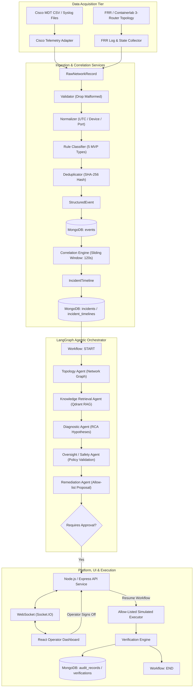
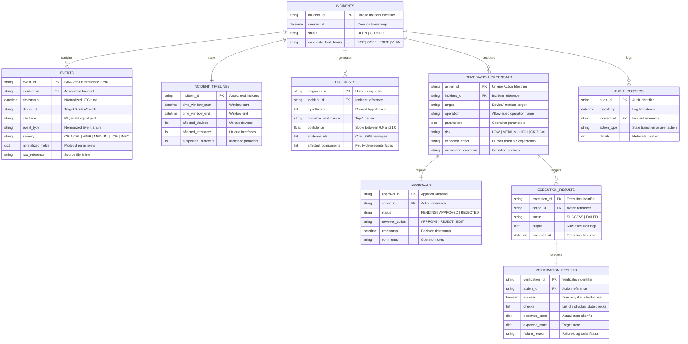
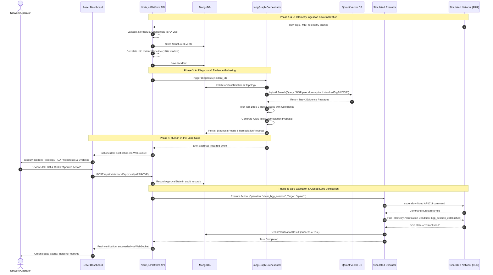
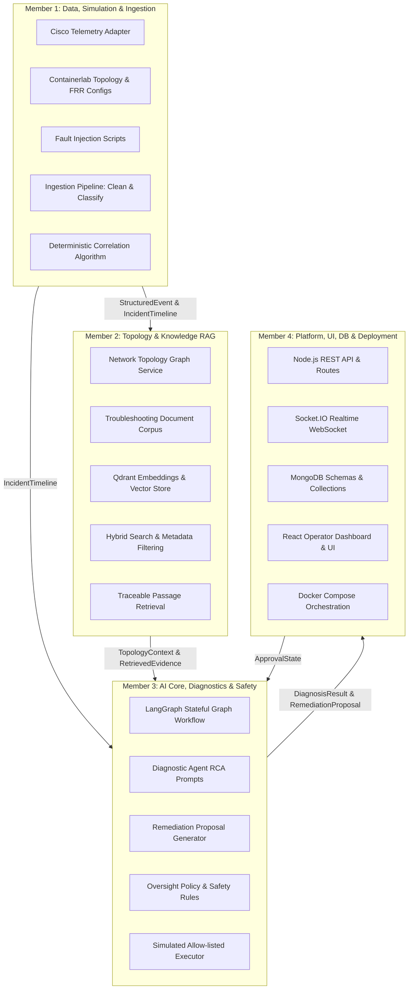
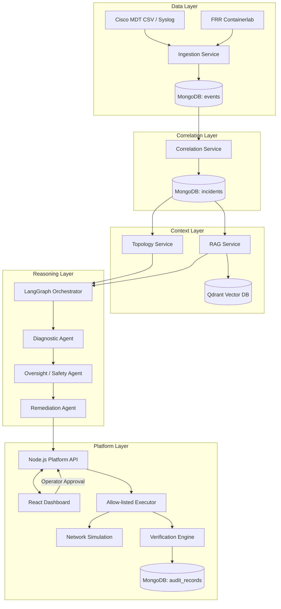
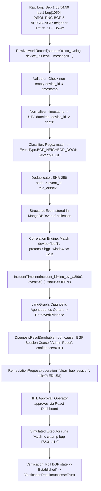
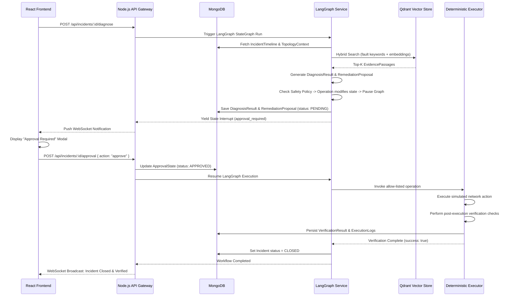
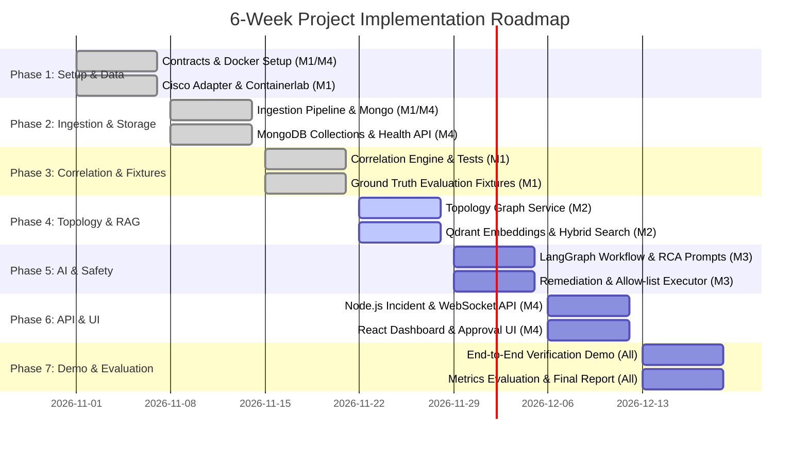
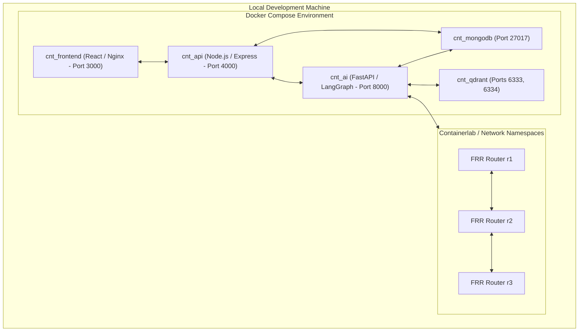

# Comprehensive Technical Architecture & Project Analysis Report

**Project Title:** Multi-Agent AI Framework for Intelligent Network Fault Diagnosis and Safe Remediation  
**Academic Context:** Computer Networks and Technologies (CNT) Course Project — 2026  
**Primary Roles:** Senior Software Architect, Lead Business Analyst, Technical Lead, and Systems Engineer  

---

## Document Discovery & Workspace Inspection Audit

Prior to performing this architecture analysis, a complete scan of the workspace was conducted.

### Identified Documents
1. **Product Requirements Document (PRD):** [`CNT_Updated_PRD_Dataset_First_Hybrid.docx`](file:///D:/SEM5/CNT/CP/CNT_Updated_PRD_Dataset_First_Hybrid.docx) (parsed & extracted completely).
2. **Technical Requirements Document (TRD):** [`CNT_Updated_TRD_Dataset_First_Hybrid.docx`](file:///D:/SEM5/CNT/CP/CNT_Updated_TRD_Dataset_First_Hybrid.docx) (parsed & extracted completely).
3. **Team Work Division Document:** [`CNT_Updated_4_Member_Detailed_Project_Division.docx`](file:///D:/SEM5/CNT/CP/CNT_Updated_4_Member_Detailed_Project_Division.docx) (parsed & extracted completely).
4. **Dataset Header Definition Documents:**
   - [`0/baseline_header_definitions.docx`](file:///D:/SEM5/CNT/CP/network/datasets/cisco-telemetry/telemetry-master/0/baseline_header_definitions.docx)
   - [`1/baseline_header_definitions.docx`](file:///D:/SEM5/CNT/CP/network/datasets/cisco-telemetry/telemetry-master/1/baseline_header_definitions.docx)
   - [`3/bgpclear_header_definitions.docx`](file:///D:/SEM5/CNT/CP/network/datasets/cisco-telemetry/telemetry-master/3/bgpclear_header_definitions.docx)
   - [`4/portflap_header_definitions.docx`](file:///D:/SEM5/CNT/CP/network/datasets/cisco-telemetry/telemetry-master/4/portflap_header_definitions.docx)
5. **Technical Architecture Markdown & Specifications (`/docs`):**
   - [`adr.md`](file:///D:/SEM5/CNT/CP/docs/adr.md) (Architecture Decision Records ADR-001 through ADR-006)
   - [`contracts.md`](file:///D:/SEM5/CNT/CP/docs/contracts.md) (Canonical inter-agent schema specification)
   - [`architecture_flow.md`](file:///D:/SEM5/CNT/CP/docs/architecture_flow.md) (Phase 0–3 architecture walkthrough)
   - [`dataset.md`](file:///D:/SEM5/CNT/CP/docs/dataset.md) (Cisco Innovation Edge MDT telemetry and syslog specifications)
   - [`ingestion.md`](file:///D:/SEM5/CNT/CP/docs/ingestion.md) (Phase 2 Ingestion pipeline specifications)
   - [`correlation.md`](file:///D:/SEM5/CNT/CP/docs/correlation.md) (Phase 3 Correlation algorithm and sliding window specs)

> [!NOTE]
> **Clarification Regarding Member Division Documents:**
> In the actual workspace repository, the team responsibilities are compiled into a unified, consolidated Master Document: **`CNT_Updated_4_Member_Detailed_Project_Division.docx`**. This document explicitly partitions tasks, file ownerships, dependencies, and delivery gates for **Member 1**, **Member 2**, **Member 3**, and **Member 4**. No separate standalone .docx files exist per person; all 4 members' responsibilities are detailed within this single source of truth.

---

## 1. Executive Summary

Modern enterprise and telecommunications networks generate massive volumes of telemetry and syslog messages during disruptions. Traditional Network Operations Center (NOC) triage relies on manual human correlation across fragmented dashboards, leading to high Mean Time to Resolution (MTTR) and human error.

The **Multi-Agent AI Framework for Intelligent Network Fault Diagnosis and Safe Remediation** solves this by establishing an autonomous, multi-agent pipeline orchestrated via **LangGraph**, backed by **MongoDB** for state and document history, **Qdrant** for vector knowledge retrieval (RAG), a **Node.js/Express** platform API, and a **React** operator dashboard.

The project employs a **Dataset-First Hybrid Strategy**:
1. **Primary Historical Telemetry:** Uses the real-world **Cisco Innovation Edge Telemetry Dataset** (Clos spine-leaf fabric running Cisco IOS-XR) to supply high-rate Model-Driven Telemetry (MDT) and syslog records for BGP anomalies, port flaps, and administrative shutdowns.
2. **Controlled Live Simulation:** Uses a 3-node **FRRouting (FRR) Containerlab** topology to generate project-owned OSPF adjacency failures and VLAN/connectivity misconfigurations, enabling reproducible, deterministic, and live demonstration of fault injection, diagnosis, and remediation.

Safety is guaranteed by strict boundary separation: **Deterministic Ingestion and Correlation Agents** clean and group raw data without LLM hallucination; a **Diagnostic Agent** produces ranked Root Cause Analysis (RCA) with verifiable evidence citations; and an **Oversight / Safety Agent** enforces a **Human-In-The-Loop (HITL)** approval gate. State-changing remediation actions are executed exclusively through an **allow-listed deterministic executor** (no arbitrary LLM-generated shell commands are ever executed).

---

## 2. Project Introduction

In modern campus, data center, and carrier networks, protocols such as BGP, OSPF, and L2 VLAN trunking form the backbone of service reachability. When a link degrades or a misconfiguration occurs, a cascading event storm erupts: line cards flap, neighbor adjacencies drop, route tables recalculate, and thousands of telemetry rows and syslog traps flood the management plane.

This project delivers a resilient, modular, course-demonstrable AI framework that ingests raw telemetry records and syslogs, normalizes them into strongly typed canonical contracts, deterministically isolates related events into incident timelines, extracts network topology context, retrieves authoritative networking playbooks via hybrid RAG, infers root causes with quantifiable confidence, and proposes verified, bounded corrective actions requiring human sign-off.

---

## 3. Problem Statement

1. **Telemetry & Log Noise:** During an outage, a single root cause (e.g., fiber cut, optical transceiver removal, or misconfigured MTU/AS number) manifests as dozens to thousands of symptoms across multiple network tiers. Network operators suffer from alert fatigue.
2. **Symptom vs. Cause Conflation:** Existing monitoring systems alert on downstream effects (e.g., `BGP_NEIGHBOR_DOWN`) rather than the originating trigger (e.g., `TRANSCEIVER_REMOVED` or `PORT_ADMIN_SHUTDOWN`).
3. **Unsafe Automation / LLM Hallucinations:** Direct LLM integration into network operations carries catastrophic risk if models hallucinate configuration commands (e.g., executing un-scoped `no router bgp` or dangerous reload commands).
4. **Lack of Verifiable Ground Truth:** Many AI prototypes claim diagnostic capability without validating predictions against known network state truths or testing whether proposed remediations actually restore data-plane health.

---

## 4. Project Objectives

1. **Source Independence:** Consume diverse inputs (Cisco IOS-XR MDT CSVs, IOS-XR syslogs, FRRouting Linux syslogs) and map them into a single canonical `StructuredEvent` schema.
2. **Deterministic Correlation:** Group correlated events into `IncidentTimeline`s using temporal windows and spatial device/interface constraints without non-deterministic LLM variance.
3. **Top-K Diagnostic Precision:** Generate Top-1 and Top-3 RCA hypotheses with supporting evidence passage IDs, confidence scores, and identified faulty components.
4. **Enforced Safety & HITL:** Mandate explicit operator authorization for state-changing operations via a React approval interface.
5. **Closed-Loop Verification:** Post-execution state inspection must verify that the protocol or interface actually recovered; execution success alone must not be confused with network recovery.
6. **Reproducible Evaluation:** Validate the AI against labeled ground truth across 5 Minimum Viable Product (MVP) scenarios.

---

## 5. Target Users

| User Persona | Role | Primary Needs / Workflow |
|---|---|---|
| **Tier-1 / Tier-2 NOC Operators** | First responders to network alerts | Needs clustered incident timelines, high-confidence root cause explanations, and recommended safe playbooks. |
| **Network Engineers / Escalation Leads** | Approvers and domain specialists | Reviews RCA hypotheses, verifies proposed CLI diffs, and approves or rejects state-changing actions. |
| **Network Automation / Site Reliability Engineers (SRE)** | Automation architects | Audits execution logs, monitors system latency, and tunes deterministic correlation rules and RAG knowledge playbooks. |
| **Academic / CNT Evaluators** | System reviewers | Assesses architectural rigor, protocol depth (BGP, OSPF, VLAN), codebase modularity, and reproducible benchmark metrics. |

---

## 6. Complete Feature Breakdown

```mermaid
graph LR
    subgraph S1 [Data Sourcing]
        A1[Cisco Telemetry MDT]
        A2[IOS-XR Syslogs]
        A3[FRR Containerlab Logs]
    end

    subgraph S2 [Data Normalization]
        B1[Validation & Parsing]
        B2[Time/Interface Normalization]
        B3[Rule Classification]
        B4[Deduplication SHA-256]
    end

    subgraph S3 [Correlation & Context]
        C1[Sliding Temporal Window]
        C2[Context Matching]
        C3[Topology Graph Extraction]
        C4[Hybrid RAG Retrieval]
    end

    subgraph S4 [AI Reasoning & Safety]
        D1[LangGraph Orchestration]
        D2[Diagnostic Agent RCA]
        D3[Remediation Proposal]
        D4[Safety & Policy Check]
    end

    subgraph S5 [Platform & Human Gate]
        E1[Operator Dashboard]
        E2[HITL Approval Gate]
        E3[Allow-listed Execution]
        E4[State Verification]
    end

    S1 --> S2 --> S3 --> S4 --> S5
```



### The 5 Minimum Viable Product (MVP) Scenarios

| Scenario # | Fault Name | Originating Source | Primary Symptom Signatures | Ground Truth Validation |
|---|---|---|---|---|
| **1** | **BGP Neighbor Anomaly / Peer Reset** | Cisco Telemetry (Cases 2, 3, 5, 6) & FRR | `%ROUTING-BGP-5-ADJCHANGE`, BGP clear command, CEASE notification | Case metadata; expected BGP session re-establishment. |
| **2** | **Port Flap** | Cisco Telemetry (Case 4) | Alternating `%PKT_INFRA-LINK-3-UPDOWN` states within short duration | Case 4 casedata log; link debounce or stabilization. |
| **3** | **Port Administrative Shutdown** | Cisco Telemetry (Cases 4, 9) | `admin-status: down`, `oper-status: down`, `state: admin-down` | Case 9 JSON ground truth; interface `no shutdown`. |
| **4** | **OSPF Adjacency Failure** | FRR Containerlab (Router R1/R2) | `OSPF-5-ADJCHANGE: Nbr state change Full -> Down`, dead-interval/hello mismatch | Injected fault record; OSPF hello restored, adjacency reaching `Full`. |
| **5** | **VLAN / L2 Connectivity Fault** | FRR / Linux bridge network | Subnet reachability loss, 802.1Q tag mismatch, missing VLAN assignment | Injected fault record; ping sweep / ARP resolution verified. |

*(Note: DHCP, DNS, MTU mismatch, and HSRP failover are designated as stretch goals post-MVP).*

---

## 7. Functional Requirements

*   **FR-001 (Multi-Source Ingestion):** Ingest raw records from Cisco MDT CSVs, IOS-XR text syslogs, and FRR container logs.
*   **FR-002 (Canonical Normalization):** Convert timestamps to UTC `datetime`, normalize interface names (e.g., `Hu0/0/0/8` $\rightarrow$ `HundredGigE0/0/0/8`), strip ASCII control characters, and extract protocol hints.
*   **FR-003 (Deterministic Deduplication):** Generate deterministic SHA-256 hashes from `(timestamp, device_id, event_type, interface, payload_fingerprint)` to guarantee idempotent storage.
*   **FR-004 (Incident Correlation):** Cluster events arriving within a sliding temporal window ($\Delta t \le 120\text{s}$) sharing device and interface/protocol context into an `IncidentTimeline`.
*   **FR-005 (Topology Context Extraction):** Graph-traverse the affected network infrastructure to extract adjacent nodes, link states, BGP peerings, and OSPF areas.
*   **FR-006 (Hybrid RAG Knowledge Retrieval):** Execute dense vector similarity (Qdrant) and lexical keyword search across network runbooks, returning chunk IDs and relevance scores.
*   **FR-007 (Hypothesis Ranking):** Formulate Top-1 and Top-3 diagnostic hypotheses with explicit confidence scores ($[0.0, 1.0]$) and supporting passage citations.
*   **FR-008 (Evidence Isolation):** Clearly delineate observed telemetry facts from probabilistic LLM reasoning.
*   **FR-009 (Bounded Remediation Formulation):** Select remediation operations strictly from a predefined allow-list with explicit targets, parameters, and rollback plans.
*   **FR-010 (Human-in-the-Loop Gate):** Halt workflow execution when a state-changing remediation is generated, requiring manual approval/rejection via the UI.
*   **FR-011 (Allow-Listed Simulation Execution):** Execute approved actions via a deterministic runner without shell generation.
*   **FR-012 (Post-Remediation Verification):** Query target device state post-execution to verify telemetry normalization against expected conditions.
*   **FR-013 (Audit Trail & Telemetry Persistence):** Record every event, incident, diagnosis, operator review, execution log, and verification status in MongoDB.

---

## 8. Non-Functional Requirements

*   **NFR-001 (Deterministic Ingestion Latency):** Ingestion and classification pipeline must process at least 100 raw records per second on standard hardware.
*   **NFR-002 (Correlation Precision):** Prevent transitive incident chaining; ensure independent faults outside temporal boundaries do not merge into single incidents.
*   **NFR-003 (Safety & Non-Executability of Arbitrary Commands):** 100% rejection rate for any command or action payload not in the verified allow-list schema.
*   **NFR-004 (Idempotency):** Reprocessing identical telemetry files must result in zero duplicate database entries (`upsert` semantics).
*   **NFR-005 (Auditability):** Every diagnostic step, retrieved knowledge chunk ID, and user decision must be permanently recorded with ISO-8601 UTC timestamps.
*   **NFR-006 (Portability):** System must run completely locally using Docker Compose without requiring external cloud infrastructure (except configurable LLM API endpoints).

---

## 9. Technology Stack

```
┌────────────────────────────────────────────────────────────────────────┐
│                          TECHNOLOGY STACK                              │
├───────────────────┬────────────────────────────────────────────────────┤
│ Frontend          │ React (Vite / CRA), Tailwind CSS / Shadcn UI       │
│ Backend API       │ Node.js, Express, Socket.IO (WebSockets)           │
│ AI & Agents       │ Python 3.11+, LangGraph, Pydantic v2, FastAPI      │
│ LLM Providers     │ OpenAI / Anthropic / Google Gemini / Ollama (Local)│
│ Primary Database  │ MongoDB 7.0 (Document Store & Audit Trail)         │
│ Vector Database   │ Qdrant 1.9.2 (Hybrid Vector & Lexical Search)      │
│ Network Sim       │ Containerlab + FRRouting (FRR 3-Router Clos)       │
│ Datasets          │ Cisco Innovation Edge MDT Telemetry (CDLA-Perm 1.0)│
│ Infrastructure    │ Docker & Docker Compose                            │
│ Test Automation   │ Pytest, Jest, Supertest                            │
└───────────────────┴────────────────────────────────────────────────────┘
```

---

## 10. System Architecture



---

## 11. Database Architecture

The persistence model is implemented using MongoDB 7.0 (database: `cnt_fault_diagnosis`). Primary collections and index strategies (from [`01_init.js`](file:///D:/SEM5/CNT/CP/database/schemas/01_init.js)):



---

## 12. API Architecture

The Node.js platform service (port 4000) exposes REST endpoints and real-time WebSockets:

| Method | Endpoint | Request Body | Response Body | Description |
|---|---|---|---|---|
| `GET` | `/health` | None | `{ service, status, version, timestamp }` | Service health check |
| `POST` | `/api/incidents` | `{ raw_records: [...] }` | `{ incident_id, status, events_count }` | Ingest/trigger incident flow |
| `GET` | `/api/incidents` | Query params: `?status=open&limit=20` | `[ IncidentSummary, ... ]` | List active/historical incidents |
| `GET` | `/api/incidents/:id` | None | `IncidentTimeline` + `TopologyContext` | Full incident details |
| `POST` | `/api/incidents/:id/diagnose` | `{ force_refresh: boolean }` | `DiagnosisResult` | Trigger LangGraph diagnostic run |
| `GET` | `/api/incidents/:id/evidence` | None | `RetrievedEvidence` | List cited RAG passages & scores |
| `POST` | `/api/incidents/:id/approval` | `{ action_id, reviewer_action, comments }` | `ApprovalState` | Submit operator approval/rejection |
| `POST` | `/api/incidents/:id/execute` | `{ action_id }` | `{ status: "executing" \| "rejected" }` | Invoke allow-listed simulator |
| `GET` | `/api/incidents/:id/verification`| None | `VerificationResult` | Fetch post-remediation verification |
| `WS` | `/ws/incidents` | WebSocket connection | Event streams: `incident_created`, `diagnosis_ready`, `approval_required` | Real-time dashboard updates |

---

## 13. Complete End-to-End Workflow



---

## 14. Detailed Module Explanations

### Module 1: Ingestion Service (`services/ai/agents/ingestion/`)
*   **Purpose:** Ingests heterogenous raw network data and converts it into canonical `StructuredEvent`s without using LLMs.
*   **Pipeline Stages:**
    1.  `validator.py`: Ensures record contains non-null `device_id`, timestamp, and non-empty syslog strings.
    2.  `normalizer.py`: Standardizes timestamps to ISO-8601 UTC `datetime`, expands interface abbreviations (`Hu0/0/0/8` $\rightarrow$ `HundredGigE0/0/0/8`), lowercases hostnames, and strips unprintable characters.
    3.  `classifier.py`: Deterministically maps logs and MDT telemetry rows into canonical `EventType`s (`BGP_NEIGHBOR_DOWN`, `PORT_FLAP`, etc.) and assigns initial `Severity` levels (`CRITICAL`, `HIGH`, `MEDIUM`, etc.).
    4.  `deduplicator.py`: Computes deterministic SHA-256 fingerprint from `(timestamp, device_id, event_type, interface, raw_message)`.
    5.  `persistence.py`: Inserts events into MongoDB `events` collection using a unique index on `event_id` to guarantee idempotency.

### Module 2: Correlation Service (`services/ai/agents/correlation/`)
*   **Purpose:** Clusters individual `StructuredEvent`s into cohesive `IncidentTimeline`s.
*   **Processing Logic:**
    *   **Rule A (Spatial Match):** Matches identical `device_id` and `interface`.
    *   **Rule B (Protocol Match):** Matches identical `device_id` and `protocol_hint` (e.g. `bgp`).
    *   **Rule C (Temporal Match):** Evaluates sliding time window $\Delta t \le 120\text{s}$ anchored to root event timestamp. Cross-device correlation is strictly disabled at this layer to avoid over-grouping; cross-device dependencies are resolved by the Topology Agent.
    *   **Recovery Detection:** Detects state transitions (e.g., `BGP_NEIGHBOR_DOWN` followed by `BGP_NEIGHBOR_UP`) and closes the incident window accordingly.

### Module 3: Topology Service (`services/topology/`)
*   **Purpose:** Constructs graph models of physical links and routing peerings.
*   **Processing Logic:** Imports network graph structures from Containerlab YAML configs and Cisco CDP ground-truth documentation. When an incident occurs on `device_A`, the service queries the graph to identify connected neighbors, peer ASNs, transit links, and path dependencies.

### Module 4: Knowledge Retrieval Service (RAG) (`services/rag/`)
*   **Purpose:** Provides factual, grounded protocol specifications and remediation runbooks.
*   **Processing Logic:** Indexes troubleshooting documentation into Qdrant. Performs hybrid retrieval (dense vector embeddings + sparse lexical matching) filtered by metadata (`protocol: "bgp"`, `vendor: "cisco-ios-xr"`). Returns chunk passages with relevance scores and passage IDs.

### Module 5: Diagnostic Agent (`services/ai/agents/diagnostic/`)
*   **Purpose:** Formulates explainable root cause analyses using LangGraph.
*   **Processing Logic:** Consumes `IncidentTimeline`, `TopologyContext`, and `RetrievedEvidence`. Produces Top-1 and Top-3 ranked `Hypothesis` objects, an overall confidence score ($[0.0, 1.0]$), and an explicit list of affected components.

### Module 6: Remediation & Oversight Agent (`services/ai/agents/remediation/`)
*   **Purpose:** Synthesizes safe corrective actions and enforces safety boundaries.
*   **Processing Logic:** Evaluates the `DiagnosisResult` against an allow-list schema. Classifies risk (`LOW`, `MEDIUM`, `HIGH`, `CRITICAL`). If an action modifies configuration or operational state, sets `requires_human_approval = True` and suspends workflow execution until operator authorization is granted.

### Module 7: Simulated Executor & Verifier (`automation/simulated-executor/`)
*   **Purpose:** Deterministically executes approved operations on the network simulation environment and confirms resolution.
*   **Processing Logic:** Accepts strictly validated parameter schemas (e.g., `operation: "clear_bgp_session", target: "spine1", peer_ip: "10.0.0.2"`). Calls the network target. Following execution, it actively samples telemetry to verify that the target condition (e.g. `bgp_session_established`) evaluates to `True`.

---

## 15. Four Team Members' Responsibilities

Based on the master specification [`CNT_Updated_4_Member_Detailed_Project_Division.docx`](file:///D:/SEM5/CNT/CP/CNT_Updated_4_Member_Detailed_Project_Division.docx):



### Detailed Breakdown per Member

#### Member 1: Dataset, Simulation, Ingestion, and Correlation
*   **Assigned Scope:** Raw telemetry adapters, network simulation infrastructure, log normalization, classification, deduplication, and deterministic temporal correlation.
*   **Owned Files:**
    *   `network/datasets/cisco-telemetry/*`
    *   `network/datasets/adapters/cisco_adapter.py`
    *   `network/containerlab/topologies/topology.yml`
    *   `network/containerlab/configs/*`
    *   `network/containerlab/fault-injection/*`
    *   `network/generators/generate_fixtures.py`
    *   `services/ai/agents/ingestion/*`
    *   `services/ai/agents/correlation/*`
*   **Deliverables:** Functional Cisco adapter yielding `RawNetworkRecord`, Containerlab 3-router FRR topology with fault injection scripts, Ingestion pipeline populating MongoDB `events`, and Correlation algorithm grouping events into `IncidentTimeline`s.

#### Member 2: Topology Service and Knowledge Retrieval (RAG)
*   **Assigned Scope:** Network graph construction, Containerlab topology integration, technical knowledge corpus curation, Qdrant vector indexing, hybrid search, and reranking.
*   **Owned Files:**
    *   `services/topology/src/*`
    *   `services/rag/src/loaders.py`
    *   `services/rag/src/cleaner.py`
    *   `services/rag/src/chunker.py`
    *   `services/rag/src/metadata.py`
    *   `services/rag/src/embeddings.py`
    *   `services/rag/src/hybrid_search.py`
    *   `services/rag/src/reranker.py`
    *   `services/rag/src/service.py`
*   **Deliverables:** Graph traversal engine returning `TopologyContext`, curated BGP/OSPF/VLAN playbook corpus in Qdrant, and hybrid search pipeline emitting `RetrievedEvidence` with relevance scores and passage IDs.

#### Member 3: AI Framework, Diagnostics, Remediation, and Safety
*   **Assigned Scope:** LangGraph orchestration, Diagnostic Agent, Remediation Agent, Safety/Oversight Agent, allow-listed simulated execution, and evaluation harness.
*   **Owned Files:**
    *   `services/ai/graph/*`
    *   `services/ai/agents/diagnostic/*`
    *   `services/ai/agents/remediation/*`
    *   `services/ai/agents/oversight/*`
    *   `services/ai/prompts/*`
    *   `services/ai/policies/*`
    *   `automation/simulated-executor/executor.py`
*   **Deliverables:** LangGraph workflow supporting interrupt-and-resume for human sign-off, diagnostic prompts generating Top-1/Top-3 hypotheses, safety filter rejecting unlisted commands, and verification runner.

#### Member 4: Platform Backend, Frontend Dashboard, Database, and Integration
*   **Assigned Scope:** Node.js/Express API gateway, Socket.IO WebSockets, MongoDB configuration, React UI dashboard, authentication/RBAC, and Docker Compose packaging.
*   **Owned Files:**
    *   `services/api/src/routes/*`
    *   `services/api/src/middleware/*`
    *   `services/api/src/websocket/*`
    *   `frontend/src/pages/*`
    *   `frontend/src/components/*`
    *   `frontend/src/api/*`
    *   `frontend/src/websocket/*`
    *   `database/schemas/*`
    *   `docker-compose.yml`
*   **Deliverables:** Express REST API with input validation, WebSocket server broadcasting incident transitions, React dashboard rendering incident timelines, network graphs, RCA evidence, and approval modals, and complete Docker Compose deployment.

---

### Team Comparison Matrix

| Team Member | Assigned Modules | Primary Responsibilities | Key Deliverables | Upstream Dependencies | Downstream Consumers |
|---|---|---|---|---|---|
| **Member 1** | Dataset, Simulation, Ingestion, Correlation | Raw data parsing, FRR topology setup, fault injection, normalization, deduplication, sliding window correlation | `cisco_adapter.py`, FRR lab configs, Ingestion pipeline, Correlation engine, test fixtures | Raw Cisco dataset & Containerlab/Docker | Members 2, 3, 4 |
| **Member 2** | Topology Context, Hybrid RAG | Network graph modeling, troubleshooting playbook corpus curation, Qdrant vector indexing, hybrid search | Topology graph service, Qdrant index, RAG retrieval engine emitting `RetrievedEvidence` | Member 1's topology definitions & incident schemas | Member 3 (Diagnostic Agent) |
| **Member 3** | LangGraph AI, Diagnostics, Remediation, Safety | Multi-agent state graph, RCA hypothesis generation, allow-listed remediation formulation, HITL pause, simulated execution & verification | LangGraph workflow, prompt templates, safety policy filter, allow-listed executor | Member 1 (`IncidentTimeline`), Member 2 (`TopologyContext`, `RetrievedEvidence`), Member 4 (`ApprovalState`) | Member 4 (Platform API / UI) |
| **Member 4** | Platform API, React UI, Database, Deployment | Express REST API, WebSockets, MongoDB collections/indexes, React incident & approval UI, Docker Compose | Node.js backend, React operator dashboard, MongoDB init scripts, Docker Compose bundle | Member 1 (data models), Member 3 (AI outputs & execution signals) | End Operator / Evaluator |

---

### Analysis of Assignments: Overlaps, Gaps, and Challenges

1. **Responsibility Overlap around Simulated Executor:**  
   *Observation:* In `CNT_Updated_4_Member_Detailed_Project_Division.docx`, Member 3 is assigned `automation/simulated-executor/executor.py` while Member 4 implements the `/api/incidents/:id/execute` endpoint.  
   *Resolution:* Member 3 implements the internal execution logic and verification state machine; Member 4 exposes the HTTP/WebSocket trigger that calls this executor upon operator approval.
2. **Directory Structure Drift in Phase 2 & 3:**  
   *Observation:* The TRD repository structure defines `services/ingestion/` and `services/correlation/` as standalone root directories. However, the existing implementation placed them under `services/ai/agents/ingestion/` and `services/ai/agents/correlation/`.  
   *Resolution:* The code is already functionally unified under `services/ai/agents/`. The documentation in `architecture_flow.md` correctly reflects this path; all team members must import from `services.ai.agents`.
3. **Approval Mechanism Ownership Clarification:**  
   *Observation:* ADR-005 explicitly mandates: *"Human approval is NOT an agent. It is a UI gate."* Member 3's LangGraph graph pauses via a state interrupt, while Member 4's UI captures the operator's decision and posts to the API to resume the graph.
4. **Unassigned Scope / Integration Gap:**  
   *Observation:* The integration tests between Node.js API and the Python LangGraph service require an inter-process communication protocol. Whether this is HTTP REST (FastAPI `services/ai/main.py`) or direct database polling was not explicitly assigned.  
   *Recommendation:* Use FastAPI on port 8000 as the internal AI service interface called by Node.js on port 4000.

---

## 16. Module Dependencies and Integration



---

## 17. Data Flow Diagrams

### Data Transformation from Raw Record to Incident Resolution



---

## 18. Sequence Diagrams

### Diagnostic & Remediation Approval Loop



---

## 19. PRD vs. TRD Comparison

| Evaluation Dimension | PRD Requirement | TRD Specification | Gap / Alignment Status |
|---|---|---|---|
| **Data Strategy** | Hybrid: Cisco Telemetry (primary) + FRR Containerlab (simulation) | Identical hybrid architecture specified with `StructuredEvent` contract | **Fully Aligned** |
| **MVP Fault Scenarios** | 5 Scenarios: BGP neighbor, Port flap, Port admin shut, OSPF adjacency, VLAN fault | Explicitly mapped to injection methods and verification criteria | **Fully Aligned** |
| **RCA Output** | Top-1 and Top-3 hypotheses with explicit confidence and citations | `DiagnosisResult` contract includes `hypotheses: list[Hypothesis]`, `confidence`, and `evidence_ids` | **Fully Aligned** |
| **Remediation & Safety** | State-changing actions require approval; no arbitrary commands | Bounded allow-list schema; HITL interrupt gate; simulated executor | **Fully Aligned** |
| **Storage Architecture** | Generic document store and vector store | Explicitly specifies MongoDB 7.0 (collections + indexes) and Qdrant 1.9.2 | **Fully Aligned** |
| **Backend & Frontend** | React dashboard and course demo deployment | React SPA, Node.js Express REST + WebSockets, Docker Compose | **Fully Aligned** |
| **Stretch Goals** | DHCP, DNS, MTU mismatch, HSRP | Deferred to future scope; excluded from core MVP test suite | **Fully Aligned** |
| **Benchmark Dataset** | FaulT-Bench evaluated as optional benchmark | Classified as optional benchmark due to emulation complexity | **Fully Aligned** |

---

## 20. Existing Codebase Analysis

### Current Implementation Status Matrix

```
┌────────────────────────────────────────────────────────┬─────────────┬─────────────┐
│ Component / Layer                                      │ Status      │ Phase       │
├────────────────────────────────────────────────────────┼─────────────┼─────────────┤
│ Pydantic v2 Canonical Contracts (contracts.py)         │ Completed   │ Phase 0     │
│ MongoDB Initialization Script (01_init.js)             │ Completed   │ Phase 0     │
│ Docker Compose (MongoDB + Qdrant)                      │ Completed   │ Phase 0     │
│ Cisco MDT CSV & Syslog Adapter (cisco_adapter.py)      │ Completed   │ Phase 1     │
│ FRR Containerlab Topology (topology.yml, configs)      │ Completed   │ Phase 1     │
│ FRR Fault Injection Scripts (fault_injection.py)       │ Completed   │ Phase 1     │
│ Ingestion Pipeline (validator, normalizer, classifier) │ Completed   │ Phase 2     │
│ Ingestion Deduplication & Mongo Persistence            │ Completed   │ Phase 2     │
│ Deterministic Correlation Engine (algorithm.py)        │ Completed   │ Phase 3     │
│ Correlation Mongo Persistence & CLI                    │ Completed   │ Phase 3     │
│ Unit & Integration Test Suites (Phases 0 to 3)         │ Completed   │ Phase 0-3   │
│ Topology Graph Service (services/topology/)            │ Scaffold    │ Phase 4     │
│ Qdrant Vector RAG Pipeline (services/rag/)             │ Scaffold    │ Phase 4     │
│ LangGraph Multi-Agent Diagnostic Graph                 │ Pending     │ Phase 5     │
│ Remediation & Safety Policy Enforcer                   │ Pending     │ Phase 5     │
│ Allow-Listed Simulated Executor                        │ Pending     │ Phase 5     │
│ Node.js Express REST API Routes (Incidents/Approvals)  │ Scaffold    │ Phase 6     │
│ React Frontend Dashboard & Approval UI                 │ Pending     │ Phase 6     │
│ Docker Compose Integration for App Services            │ Pending     │ Phase 7     │
└────────────────────────────────────────────────────────┴─────────────┴─────────────┘
```

### Detailed Component Verification

1. **Phase 0 (Foundations & Canonical Contracts):**
   - [`services/ai/schemas/contracts.py`](file:///D:/SEM5/CNT/CP/services/ai/schemas/contracts.py): Fully implemented with Pydantic v2. Defines `StructuredEvent`, `IncidentTimeline`, `TopologyContext`, `RetrievedEvidence`, `DiagnosisResult`, `RemediationProposal`, `ApprovalState`, and `VerificationResult`.
   - [`tests/unit/test_contracts.py`](file:///D:/SEM5/CNT/CP/tests/unit/test_contracts.py): 100% test coverage validating schema types, boundary values, and enum enforcements.
   - [`database/schemas/01_init.js`](file:///D:/SEM5/CNT/CP/database/schemas/01_init.js): Fully defines 9 collections and indexes (e.g., unique index on `event_id`, index on `incident_id`).
   - [`docker-compose.yml`](file:///D:/SEM5/CNT/CP/docker-compose.yml): Configured with healthy checks for MongoDB 7.0 and Qdrant 1.9.2.

2. **Phase 1 (Data Acquisition & Simulation):**
   - [`network/datasets/adapters/cisco_adapter.py`](file:///D:/SEM5/CNT/CP/network/datasets/adapters/cisco_adapter.py): High-performance streaming parser for Cisco gzip CSVs and IOS-XR syslog files. Supports ground-truth label loading.
   - [`network/containerlab/`](file:///D:/SEM5/CNT/CP/network/containerlab/): Complete 3-node FRR Clos topology (`topology.yml`) with individual daemon configs (`daemons`, `frr.conf`, `vtysh.conf`) for routers `r1`, `r2`, and `r3`.
   - [`network/containerlab/fault-injection/fault_injection.py`](file:///D:/SEM5/CNT/CP/network/containerlab/fault-injection/fault_injection.py): Programmatic fault injector for BGP teardown, OSPF hello interval corruption, link failure, and MTU mismatch.

3. **Phase 2 (Ingestion Agent Pipeline):**
   - [`services/ai/agents/ingestion/`](file:///D:/SEM5/CNT/CP/services/ai/agents/ingestion/): Fully implemented with dedicated `validator.py`, `normalizer.py`, `classifier.py`, `deduplicator.py`, and `persistence.py`. Validated via [`tests/unit/test_phase2_ingestion.py`](file:///D:/SEM5/CNT/CP/tests/unit/test_phase2_ingestion.py).

4. **Phase 3 (Correlation Agent):**
   - [`services/ai/agents/correlation/`](file:///D:/SEM5/CNT/CP/services/ai/agents/correlation/): Fully implemented deterministic correlation engine (`algorithm.py`, `service.py`, `persistence.py`). Enforces strict 120-second sliding windows, device/interface clustering, and prevents transitive chaining. Validated via [`tests/unit/test_phase3_correlation.py`](file:///D:/SEM5/CNT/CP/tests/unit/test_phase3_correlation.py).

5. **Phases 4 to 6 (Scaffolded & Pending):**
   - `services/topology/` and `services/rag/` exist as placeholder directories with `.gitkeep`.
   - `services/api/src/index.js`: Exposes `/health`; incident routing and WebSockets are commented placeholders.
   - `frontend/`: Directory created; React application files have not yet been initialized.

---

## 21. Missing Features and Documentation Gaps

1. **AI Service to API Gateway Protocol Specification:**  
   The TRD specifies that Node.js provides REST APIs and WebSockets, while the AI service is implemented in Python. However, the exact RPC mechanism between Node.js and Python (whether Node calls FastAPI over HTTP at `http://ai:8000/run_diagnosis` or whether both coordinate asynchronously via MongoDB collections) should be standardized.  
   *Architecture Recommendation:* Use FastAPI HTTP endpoints for synchronous trigger requests, with MongoDB serving as the persistent shared state store.
2. **Qdrant Embedding Model Selection:**  
   The TRD mentions semantic retrieval in Qdrant but does not mandate a specific embedding model (e.g., `text-embedding-3-small`, `all-MiniLM-L6-v2`, or FastEmbed).  
   *Architecture Recommendation:* Use local FastEmbed (`BAAI/bge-small-en-v1.5`) to eliminate external API costs and rate limits during local evaluation.
3. **Frontend Component Architecture Specification:**  
   The PRD and TRD specify UI screens for Incident Timeline, Topology View, RCA & Evidence, and Approval Modal, but do not provide a UI layout wireframe or state management plan.  
   *Recommendation:* Implement a modular React SPA using TanStack Query (React Query) for API polling and Socket.IO-client for real-time incident event pushes.

---

## 22. Potential Risks and Challenges

1. **Docker Availability on Host Machine:**  
   *Documented Fact (ADR-006):* The host environment terminal initially did not have Docker in its active PATH. Containerlab and Dockerized services require a running Docker daemon.  
   *Mitigation:* Local testing can run directly against native Python and Node.js environments; Containerlab can be run inside WSL2 or an Ubuntu VM if Windows native containerization is constrained.
2. **LLM Non-Determinism in Diagnosis:**  
   *Risk:* LLMs can generate varying confidence scores or slightly different root cause wordings for identical incidents.  
   *Mitigation:* Temperature must be set to `0.0`. Prompts must enforce structured JSON output adhering to Pydantic schemas via LangChain/LangGraph structured output formatting.
3. **Correlation Window Tuning:**  
   *Risk:* In high-churn networks, a 120-second window might cluster unrelated events if interface flaps occur concurrently.  
   *Mitigation:* The correlation engine enforces strict spatial matching (same device and either same interface or same protocol) to prevent false clustering.

---

## 23. Implementation Roadmap



### Phase Breakdown

*   **Phase 1: Project Setup & Canonical Foundation (Week 1) — COMPLETED**  
    *Tasks:* Establish monorepo; define Pydantic v2 data contracts (`contracts.py`); write contracts unit test suite; configure `docker-compose.yml` (MongoDB + Qdrant); implement Cisco dataset streaming adapter; scaffold FRR Containerlab topology.  
    *Completion Criteria:* All contract tests pass; Cisco adapter parses sample records into `RawNetworkRecord`.
*   **Phase 2: Ingestion Pipeline & Persistence (Week 2) — COMPLETED**  
    *Tasks:* Implement Ingestion pipeline (`validator`, `normalizer`, `classifier`, `deduplicator`); set up MongoDB unique indexing; verify idempotent persistence.  
    *Completion Criteria:* Raw logs ingested into MongoDB `events` collection without duplicates.
*   **Phase 3: Event Correlation & Ground-Truth Verification (Week 3) — COMPLETED**  
    *Tasks:* Build deterministic sliding-window correlation engine; implement recovery state detection; produce `IncidentTimeline`s; create evaluation test fixtures for BGP clear and port flaps.  
    *Completion Criteria:* Correlated incidents persisted in MongoDB; unit tests confirm prevention of transitive chaining.
*   **Phase 4: Topology Service & Hybrid RAG Engine (Week 4) — CURRENT SPRINT**  
    *Tasks (Member 2):* Implement network graph model from Containerlab configs; construct troubleshooting corpus (BGP, OSPF, VLAN); index chunks into Qdrant; build hybrid search and reranking emitting `RetrievedEvidence`.  
    *Completion Criteria:* Incident query returns relevant runbook passages with traceable source IDs.
*   **Phase 5: LangGraph AI Diagnostics, Safety & Simulated Execution (Week 5)**  
    *Tasks (Member 3):* Construct LangGraph state machine; implement Diagnostic Agent with Top-1/Top-3 RCA; implement Remediation Agent with allow-listed operations; build human approval interrupt; implement deterministic executor and verification check.  
    *Completion Criteria:* End-to-end diagnosis runs on sample incident; state-changing action triggers workflow pause; verified simulation execution.
*   **Phase 6: Platform API, Real-Time WebSockets & React Dashboard (Week 5–6)**  
    *Tasks (Member 4):* Implement Express routes for incidents, evidence, and approvals; set up Socket.IO server; build React dashboard (Timeline, Topology map, RCA view, Approval modal, Verification status).  
    *Completion Criteria:* Operator can view incidents, inspect RCA evidence, and approve remediation in the browser.
*   **Phase 7: End-to-End Testing, Benchmark Evaluation & Packaging (Week 6)**  
    *Tasks (All Members):* Run full end-to-end integration tests (Inject $\rightarrow$ Correlate $\rightarrow$ Diagnose $\rightarrow$ Approve $\rightarrow$ Remediate $\rightarrow$ Verify); run evaluation benchmark against ground-truth datasets; package final documentation and presentation slides.  
    *Completion Criteria:* 100% pass on core scenarios; reproducible evaluation metrics; live demonstration readiness.

---

## 24. Testing Strategy

1. **Unit Testing (Determinism & Schemas):**
   - Canonical contract validation via Pytest ([`test_contracts.py`](file:///D:/SEM5/CNT/CP/tests/unit/test_contracts.py)).
   - Ingestion normalization, classification, and deduplication ([`test_phase2_ingestion.py`](file:///D:/SEM5/CNT/CP/tests/unit/test_phase2_ingestion.py)).
   - Correlation window boundary and recovery detection ([`test_phase3_correlation.py`](file:///D:/SEM5/CNT/CP/tests/unit/test_phase3_correlation.py)).
   - Node.js API health and middleware testing via Jest and Supertest ([`health.test.js`](file:///D:/SEM5/CNT/CP/services/api/tests/health.test.js)).
2. **Integration Testing (Component Handoffs):**
   - Ingestion to MongoDB persistence ([`test_phase2_ingestion_mongo.py`](file:///D:/SEM5/CNT/CP/tests/integration/test_phase2_ingestion_mongo.py)).
   - Correlation to MongoDB `incident_timelines` ([`test_phase3_correlation_mongo.py`](file:///D:/SEM5/CNT/CP/tests/integration/test_phase3_correlation_mongo.py)).
   - RAG retrieval recall on known networking failure queries.
3. **Safety & Policy Testing:**
   - Attempt to pass unlisted or arbitrary shell commands to the Simulated Executor; assert 100% rejection.
   - Verify that all state-changing remediation proposals remain in `PENDING` status until an explicit `APPROVE` action is submitted.
4. **End-to-End Live Scenario Testing:**
   - Ingest Case 3 (BGP clear) from Cisco dataset; verify Top-1 RCA identifies BGP session reset; verify proposed action is `clear_bgp_session`; confirm post-verification state.
   - Inject live OSPF hello mismatch in Containerlab; verify system alerts on OSPF adjacency down; approve interface reconfiguration; verify neighbor reaches `Full`.

---

## 25. Deployment Strategy

The application is deployed locally via Docker Compose, isolating services into dedicated containers sharing an internal bridge network (`cnt_network`):



---

## 26. Important Questions and Unresolved Decisions

1. **AI Service Communication Style:**  
   *Current state:* `services/ai/main.py` is configured with FastAPI, while `services/api/src/index.js` is built with Express.  
   *Question for Team:* Will the Express API trigger LangGraph runs via direct HTTP POST to FastAPI (`http://localhost:8000/diagnose`), or will both services poll MongoDB change streams?  
   *Recommendation:* Direct HTTP POST simplifies error propagation and synchronous UI feedback.
2. **Containerlab Execution Environment:**  
   *Current state:* Containerlab relies on Linux network namespaces and Docker. On Windows machines without native Linux Docker support, Containerlab must be run within WSL2 (Windows Subsystem for Linux).  
   *Question for Team:* Has WSL2 Docker integration been verified on all team members' laptops?  
   *Recommendation:* Use mock telemetry replay for local development if WSL2 is not installed, reserving live Containerlab runs for the integration testbed.
3. **Qdrant Embedding Strategy:**  
   *Current state:* Qdrant is running in Docker, but the embedding model provider is unconfigured in `services/rag/`.  
   *Recommendation:* Standardize on `fastembed` (all-MiniLM-L6-v2) within Python to enable completely offline, zero-cost vector indexing.

---

## 27. Final Complete Project Explanation

### Teaching Guide: From Beginner to Advanced

If you are a software engineer or network technician joining this project today, here is everything you need to know to understand the entire architecture:

#### The Big Picture (Beginner Level)
Imagine a massive airport where hundreds of planes land every hour. If one runway closes due to debris, dozens of subsequent flights are delayed, baggage handlers get confused, gate assignments change, and alarms ring across every terminal. 
In a computer network, a router interface going down is like that closed runway. Instantly, BGP sessions drop, OSPF routes disappear, and thousands of warning messages flood the operations screen.
Currently, human engineers have to read through thousands of lines of logs to figure out what happened. **Our project is an intelligent AI assistant that does this triage automatically.** It catches the flood of logs, cleans them up, groups the related alarms into a single incident, looks at the network map, consults standard engineering manuals, pinpoints the root cause, and says to the operator: *"Router 1's port was shut down. Here is the verified evidence. Click 'Approve' to re-enable it safely."*

#### The Internal Mechanics (Intermediate Level)
1. **How Data Enters the System:**  
   Network data comes from two sources: historical Cisco data center logs (MDT CSVs and syslogs) and our live simulated network running inside Docker containers using FRRouting (FRR).
2. **How Data is Sanitized:**  
   Raw logs are messy. Timestamps use different formats, interface names are abbreviated (`Hu0/0/0/8` vs `HundredGigE0/0/0/8`), and duplicate messages arrive constantly. Our **Ingestion Agent** validates every record, standardizes timestamps to UTC, classifies the event into one of our 5 core scenarios (like `BGP_NEIGHBOR_DOWN`), generates a unique SHA-256 fingerprint, and saves it into MongoDB.
3. **How Events are Correlated:**  
   The **Correlation Agent** monitors incoming events. If events occur on the same router within 120 seconds of each other and involve the same interface or protocol, it groups them into an **`IncidentTimeline`**. This turns 50 noisy alerts into 1 structured story.
4. **How the AI Reasons:**  
   Once an incident is packaged, our **LangGraph AI Orchestrator** wakes up. It asks the **Topology Agent** for the network map around the affected router. It then queries **Qdrant** (our vector database) using hybrid search to find the exact troubleshooting guide for that failure.
5. **How Diagnoses are Formed:**  
   The **Diagnostic Agent** reads the incident timeline, the network map, and the troubleshooting manual. It produces a ranked list of explanations (Top-1 and Top-3), gives a confidence score (e.g., 95%), cites the exact manual passages, and generates a safe repair proposal.

#### The Safety Core & Platform (Advanced Level)
1. **Why LLMs Are Not Allowed to Run Shell Commands:**  
   Allowing an LLM to generate raw Bash or Cisco CLI commands is extremely hazardous. An LLM might hallucinate `no router bgp` and wipe out an entire autonomous system. In our system, the Remediation Agent can **only** pick from a strict, hard-coded allow-list of operations (e.g., `clear_bgp_session`, `interface_no_shutdown`).
2. **The Human-in-the-Loop Gate:**  
   When a state-changing remediation is generated, the LangGraph workflow halts. It emits an event to the Node.js API, which pushes a notification over WebSockets to the React frontend. An operator must review the root cause and click **"Approve Action"**.
3. **Simulated Execution & Closed-Loop Verification:**  
   Once approved, the **Simulated Executor** carries out the allow-listed operation. Immediately afterward, the **Verifier** checks the router's live telemetry. Only if the protocol actually recovers (e.g., BGP transitions back to `Established`) does the system mark the incident as `RESOLVED`.
4. **Current Status & Next Steps:**  
   Phases 0 through 3 (Contracts, Ingestion, and Correlation) are completely implemented and backed by rigorous unit and integration tests. The next tasks are building the Topology and Qdrant RAG services (Member 2), assembling the LangGraph diagnostic graph and executor (Member 3), and building the React UI and API routes (Member 4).

---
*This report serves as the complete, authoritative system architecture baseline for all subsequent development, integration, and evaluation.*

