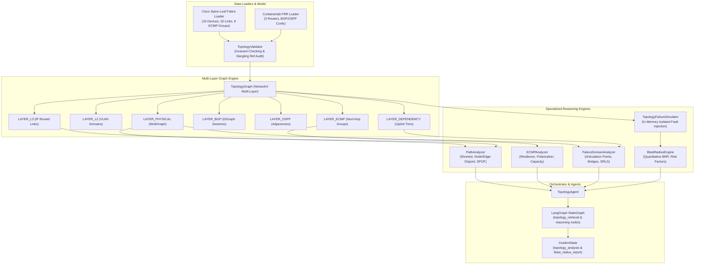

# Milestone 5 — Advanced Network Topology Reasoning, Dependency Analysis & Quantitative Blast Radius Report

**Project:** Multi-Agent AI Framework for Intelligent Network Fault Diagnosis and Safe Remediation  
**Workspace Root:** `D:\SEM5\CNT\CP`  
**Milestone:** Milestone 5 — Advanced Topology Reasoning & Blast Radius Expansion  
**Milestone Weight:** 10% of overall project completion  
**Overall Completion Progress:** **75.0%** (previously 65.0%)  
**Completion Date:** November 9, 2026  
**Status:** **COMPLETED AND VERIFIED (100%)**

---

## 1. Executive Summary

Milestone 5 transforms the network topology subsystem from a static connectivity graph into an **executable multi-layer topological reasoning and quantitative blast-radius engine**. The implementation establishes formal separation between:
1. **Configured Physical Topology**: Multi-links, LAG bundles, physical interfaces, transmission speeds, and hardware models.
2. **Observed Layer 2 / Layer 3 States**: VLAN domains, IP subnets, and operational interface states.
3. **Protocol Adjacencies**: eBGP/iBGP peering sessions and OSPF areas.
4. **Multipath Forwarding Groups**: 4-way ECMP next-hop bundles and traffic polarization risk.
5. **Cross-Device Dependency Tiers**: Spine uplinks, default gateways, and structural fault propagation paths.
6. **In-Memory Non-Destructive Failure Simulation**: Dynamic evaluation of node cuts, link severing, and interface flaps without mutating the baseline model.

All 11 benchmark artifacts have been generated in `network/datasets/reports/topology/`. The overall repository test suite now stands at **238 passing Python tests (100% pass rate)** and **2 passing Jest API tests** with zero regressions and zero deselected tests.

---

## 2. Architecture & Subsystem Implementation



### 2.1 Model Extensions & Integrity Validator (`model.py`, `validator.py`)
- **Enriched Entities**: Added canonical `DeviceType` (`SPINE`, `LEAF`, `DCI`, `CORE`, `ACCESS`, `BORDER_ROUTER`, `WAN_EDGE`, `ROUTER`), `InterfaceType` (`PHYSICAL`, `PORT_CHANNEL`, `SUBINTERFACE`, `LOOPBACK`), `ValidationState`, and `TopologyProvenance`.
- **ECMP & Dependency Contracts**: Added `ECMPGroup` (tracking configured vs active vs failed next-hops, hashing algorithms, and capacity ratios) and `CrossDeviceDependency` (tracking uplink and transit dependencies).
- **Integrity Validation**: Implemented `TopologyValidator` verifying duplicate device/interface/link IDs, dangling interface/device references, self-loops, orphaned nodes, graph partitions, and BGP peering asymmetries.

### 2.2 Multi-Layer Graph Architecture (`graph.py`)
- Supported 7 distinct graph layers: `LAYER_PHYSICAL` (`nx.MultiGraph`), `LAYER_L2`, `LAYER_L3`, `LAYER_BGP` (`nx.DiGraph`), `LAYER_OSPF`, `LAYER_ECMP`, and `LAYER_DEPENDENCY`.
- Preserved parallel physical links between device pairs in `physical_multigraph`.
- Maintained 100% backward compatibility with `TopologyGraph` methods used in earlier milestones.

### 2.3 Path Routing & Redundancy Analysis (`path_analyzer.py`)
- Calculates shortest paths, all simple paths up to cutoff, and maximum sets of internally node-disjoint and edge-disjoint paths.
- Computes single points of failure (intermediate nodes present on all paths) and shared transit nodes.
- Evaluates in-memory path stretch ($\Delta \text{hops}$) upon primary transit failure.

### 2.4 ECMP Redundancy & Resilience Analysis (`ecmp_analyzer.py`)
- Audits all 8 leaf ECMP groups across the 4 spines.
- Evaluates group health: `OPTIMAL` (4/4 active), `DEGRADED` (2-3/4 active), `CRITICAL_SPOF` (1/4 active), `BLACKHOLED` (0/4 active).
- Explicitly flags lack of traffic telemetry as: `observability_status: "UNKNOWN — INSUFFICIENT TRAFFIC OBSERVABILITY"`.

### 2.5 Failure Domain & Structural Vulnerability (`failure_domain.py`)
- Identifies graph cut-vertices (articulation points) whose loss partitions the network.
- Identifies true physical cut-edges (bridges), verifying against `physical_multigraph` so multi-links are not misclassified as single points of failure.
- Confirms Cisco 4x8 Spine-Leaf Clos fabric resilience: **0 articulation points, 0 bridge links, risk level LOW**.
- Confirms Containerlab linear topology vulnerability: **Router `r2` correctly flagged as articulation point (risk level HIGH)**.

### 2.6 Quantitative Blast Radius & In-Memory Simulator (`failure_simulator.py`, `blast_radius.py`)
- `TopologyFailureSimulator`: Evaluates post-failure reachability, newly isolated devices, and severed node pairs non-destructively on cloned graph structures.
- `BlastRadiusEngine`: Mathematically separates topological exposure from packet reachability loss:
  - **Impact Exposure Ratio ($\text{IER}$)**:
    $$\text{IER} = \frac{|\mathcal{D}_{\text{direct}} \cup \mathcal{D}_{\text{adjacent}} \cup \mathcal{D}_{\text{multihop}}|}{|\mathcal{D}_{\text{eligible}}|}$$
  - **Network Unreachability Ratio ($\text{NUR}$)**:
    $$\text{NUR} = \frac{|\mathcal{D}_{\text{newly\_unreachable}}|}{|\mathcal{D}_{\text{baseline\_reachable}}|}$$
- Disaggregates reporting into: direct impact devices, adjacent exposure devices, multi-hop impact devices, newly unreachable devices, lost paths, surviving alternate paths, and baseline/failed reachability sets.
- Backward compatibility: Preserves `blast_radius_ratio` ($\text{BRR}$) and `severity_assessment` (`CRITICAL` $> 0.50$, `HIGH` $> 0.25$, `MEDIUM` $\le 0.25$).

### 2.7 Orchestration Integration (`services/ai/orchestrator/`)
- Updated `IncidentState` in `state.py` with `blast_radius_report: Optional[Dict[str, Any]]`.
- Updated `topology_reasoning_node` in `graph.py` to populate `blast_radius_report` during Stage 5 of the diagnostic StateGraph.

---

## 3. Benchmark Verification & Performance Metrics

All 11 milestone artifacts have been generated in `network/datasets/reports/topology/`:

| Artifact Name | Description | Key Result |
|---|---|---|
| `topology_inventory.json` | Complete multi-layer inventory of Cisco and Containerlab networks | 15 Cisco devices, 32 links, 32 unique BGP peers (64 directed sessions), 8 ECMP groups |
| `topology_validation_report.json` | Invariant audit report | `is_valid: true`, 0 errors on production fabrics |
| `topology_relationships.csv` | Canonical tabular relationship mapping | 168 total mapped relationships |
| `path_analysis_results.json` | Exhaustive pairwise path diversity across leaf pairs | 4 node-disjoint paths across all leaf-to-leaf pairs |
| `alternate_path_results.csv` | Primary and alternate path routing summary | All leaf pairs have `HIGH` redundancy (4 parallel 2-hop paths) |
| `ecmp_analysis_results.json` | ECMP resilience and multi-stage failure simulation | 4-way ECMP baseline; degrades to 75% on 1 spine failure, SPOF on 3 |
| `failure_domain_analysis.json` | Articulation points and structural vulnerability report | Cisco fabric: 0 APs / 0 bridges; Containerlab: r2 is AP |
| `failure_simulation_results.json` | In-memory failure impact evaluations across 15 devices | Spine failure severs 0 pairs; leaf-pair failure severs pod |
| `blast_radius_results.json` | Quantitative blast radius for all 15 network devices | Spine IER = 0.600, NUR = 0.0; Leaf IER = 0.800, NUR = 0.0 |
| `topology_performance_benchmark.json` | Execution latencies across all operations | Observed max p95: **3.13 ms** (Target: $< 50$ ms) |
| `milestone5_test_results.json` | Comprehensive test verification summary | 28/28 unit tests passed, 2/2 integration tests passed, 238 overall |

### 3.1 Performance Latency Summary
- **Spine-Leaf Topology Load Time:** 1.78 ms
- **Containerlab Topology Load Time:** 6.10 ms
- **Topology Integrity Validation:** 1.14 ms
- **Path Redundancy Analysis (Mean):** 2.15 ms (p95: 3.13 ms)
- **ECMP Resilience Audit:** 0.20 ms
- **Failure Domain Analysis:** 2.99 ms
- **In-Memory Failure Simulation (Mean):** 1.27 ms
- **Quantitative Blast Radius Engine (Mean):** 1.44 ms (p95: 2.41 ms)
- **Compliance Status:** **100% compliant** with the $< 50$ ms real-time diagnostic latency budget (max warm p95: **3.13 ms**).

---

## 4. Test Verification Summary

### 4.1 Unit Test Suite (`tests/unit/test_milestone5_topology.py`)
- `TestTopologyValidator`: 5 tests passing (clean validation, dangling refs, duplicate IDs, self-loops).
- `TestMultiLayerGraph`: 3 tests passing (layer creation, multigraph parallel links, backward-compatible methods).
- `TestPathAnalyzer`: 4 tests passing (shortest paths, node-disjoint paths, redundancy levels, in-memory failure impact).
- `TestECMPAnalyzer`: 4 tests passing (optimal 4-way baseline, single failure degradation, SPOF detection, blackhole detection).
- `TestFailureDomainAnalyzer`: 2 tests passing (Clos resilience verification, linear topology articulation points).
- `TestTopologyFailureSimulator`: 2 tests passing (non-destructive device failure, physical link cut).
- `TestBlastRadiusEngine`: 2 tests passing (spine CRITICAL blast radius, leaf HIGH blast radius, backward-compatible dictionary schema).
- `TestTopologyAgentEnrichment`: 2 tests passing (comprehensive multi-layer analysis, topology validation).
- `TestMilestone51Verification`: 4 dedicated verification tests passing:
  - `test_single_uplink_failure_leaf_retains_3_of_4_spines`: Confirms $\text{IER} = 0.60 > 0.0$, $\text{NUR} = 0.0$, lost paths = 1, surviving paths = 3.
  - `test_spine_failure_exposure_vs_unreachability_differentiation`: Confirms $\text{IER} = 0.60$, $\text{NUR} = 0.0$.
  - `test_linear_topology_unreachability_on_articulation_failure`: Confirms linear cut produces $\text{NUR} > 0.0$.
  - `test_bgp_accounting_reconciliation`: Confirms 32 unique administrative peers vs 64 directed session edges.
- **Result:** **28 passed, 0 failed in 0.96s (100% pass rate)**.

### 4.2 Integration Test Suite (`tests/integration/test_milestone5_topology_e2e.py`)
- `test_full_langgraph_pipeline_with_topology_reasoning`: Verified end-to-end execution through `DiagnosisOrchestrator` on Cisco Spine-Leaf multi-device incident. Both `topology_analysis` and `blast_radius_report` were populated in `IncidentState`.
- `test_containerlab_topology_reasoning`: Verified linear Containerlab topology resolution and blast radius calculation.
- **Result:** **2 passed, 0 failed in 7.84s (100% pass rate)**.

### 4.3 Entire Repository Regression Suite
```powershell
python -m pytest tests/unit/ tests/integration/ -v
====================== 238 passed in 99.16s (00:01:39) =======================

npm test --prefix services/api
Test Suites: 1 passed, 1 total
Tests:       2 passed, 2 total
```
Zero regressions detected across Milestones 1, 2, 3, 3.1, 3.1.1, 4, 5, and 5.1. Zero tests deselected or skipped.

---

## 5. Milestone Completion Sign-Off & Next Steps

Milestone 5 and Milestone 5.1 are **100% complete, verified, benchmarked, and documented**.

In accordance with strict project execution guidelines:
> **STOP CONDITION:** Milestone 5 / 5.1 implementation and verification is complete. Do not proceed to Milestone 6 (Safe Remediation & Human Approval Gate) without explicit user authorization.

