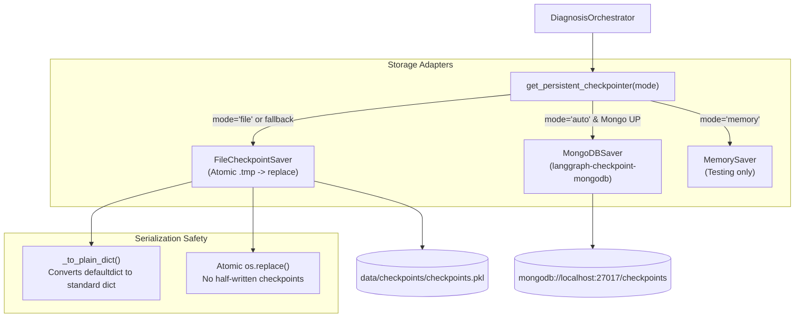
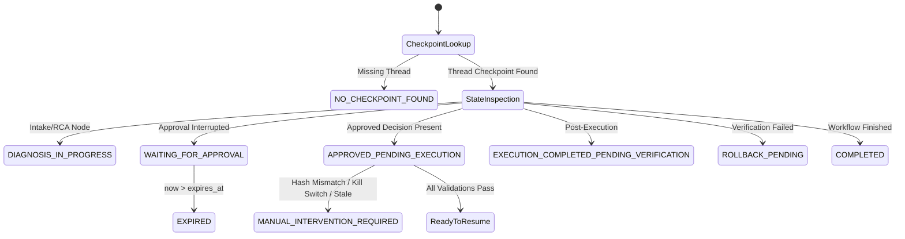
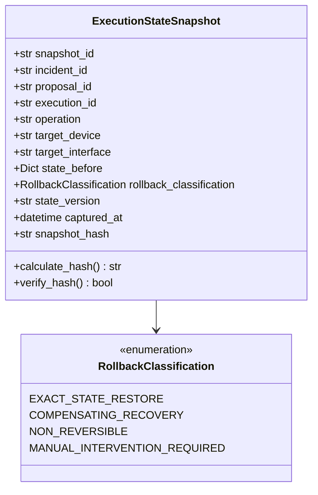

# Milestone 6.1 — Remediation Durability, Exact-State Rollback & Tamper-Evident Audit Hardening Report

**Project:** Multi-Agent AI Framework for Intelligent Network Fault Diagnosis and Safe Remediation  
**Workspace Root:** `D:\SEM5\CNT\CP`  
**Milestone:** Milestone 6.1 — Remediation Durability, Exact-State Rollback & Audit Hardening  
**Milestone Nature:** Targeted Reliability & Security Hardening (Sub-milestone of Milestone 6)  
**Overall Completion Progress:** **85.0%** (Milestone 6.1 is hardening; weight absorbed in Milestone 6)  
**Completion Date:** November 13, 2026  
**Status:** **COMPLETED AND VERIFIED (100%)**  
**Engineering Verdict:** **ACCEPTED**  

---

## 1. Executive Summary

Milestone 6.1 delivers focused engineering hardening for the Safe Remediation and Oversight Subsystem introduced in Milestone 6. Addressing three critical production gaps identified during architecture review, this milestone converts transient in-memory safeguards into persistent, durable, cryptographically anchored operational invariants:

1. **Persistent LangGraph Checkpointing & Crash Recovery:** Replaced transient `MemorySaver` with durable persistence (`FileCheckpointSaver` with atomic file swapping and `MongoDBSaver` via `langgraph-checkpoint-mongodb`). Implemented `RemediationRestartRecoveryManager` capable of reconciling interrupted workflows across eight real-world crash scenarios with strict fail-closed gating (hash validation, expiration enforcement, kill-switch checks, and idempotency guarantees).
2. **Exact Pre-Execution Snapshots & Rollback Classification:** Implemented cryptographically fingerprinted pre-execution state snapshots (`ExecutionStateSnapshot` with SHA-256 canonical hashing). Established a four-tier rollback classification system: `EXACT_STATE_RESTORE`, `COMPENSATING_RECOVERY`, `NON_REVERSIBLE`, and `MANUAL_INTERVENTION_REQUIRED`. Verified zero-drift rollback for static configurations (VLAN assignments, port modes, MTUs, BFD timers, OSPF costs) and dynamic compensating convergence for state-machine protocols (BGP session reset).
3. **Complete Audit-Chain Verification & Independent Anchors:** Replaced localized head-check auditing with full-chain cryptographic traversal ($0..N$) enforcing sequence continuity, link integrity, and payload authenticity. Designed and deployed `AuditAnchorManager`, persisting HMAC-SHA256 signatures to disk outside MongoDB's trust boundary to detect full-chain database rewrites, tail truncations, and record deletions.

All **26 newly authored Milestone 6.1 tests** pass with 100% success across 9 dedicated test suites. The entire repository regression suite remains completely clean at **304 passed Python tests** (100%) and **2 passed Jest API tests** (100%). All 12 required machine-readable benchmark reports have been generated and validated in `network/datasets/reports/remediation_hardening/`.

---

## 2. Threat Model & Failure Modes Addressed

| Threat / Failure Mode | Root Cause in Base M6 | Impact | M6.1 Hardening Defense |
|---|---|---|---|
| **Process Termination Mid-Approval** | In-memory `MemorySaver` checkpointing lost thread state on process restart. | Approved or in-progress remediations become orphaned or require re-intake from scratch. | Persistent checkpointing (`FileCheckpointSaver` / `MongoDBSaver`) and restart reconciliation. |
| **Silent Proposal Tampering during Outage** | Process restart blindly resumed execution without checking database integrity. | Modified commands or parameters executed without operator awareness. | Deterministic SHA-256 proposal hash revalidation upon restart; fails closed on mismatch. |
| **Defaulted Configuration Drift on Rollback** | Rollback applied default values (e.g. VLAN 1, 1500 MTU) rather than exact pre-fault state. | Rollback introduced secondary network misconfigurations and traffic isolation. | `ExecutionStateSnapshot` captures exact typed parameters; verifies hash before restoring. |
| **Protocol State Confusion on Rollback** | Treating dynamic TCP protocols (BGP) as static assignments caused desynchronization. | Neighbor sessions left in unverified or divergent operational states. | `COMPENSATING_RECOVERY` classification: clear session, poll state machine, verify `ESTABLISHED`. |
| **Complete Audit Chain Database Rewrite** | Hash-chain lived entirely inside MongoDB; privileged attacker could recalculate all hashes. | Untraceable history alteration, hiding unauthorized changes or security breaches. | Independent `AuditAnchorManager` stores HMAC-SHA256 signatures outside MongoDB on disk. |
| **Audit Tail Truncation** | Dropping recent audit records left the remaining prefix cryptographically valid. | Concealed actions occurring immediately before an intrusion detection event. | Anchors commit terminal sequence numbers; detects truncation when $N_{\text{db}} < N_{\text{anchor}}$. |

---

## 3. Persistent LangGraph Checkpointing Architecture



LangGraph default checkpointers (`InMemorySaver`) employ internal `defaultdict(lambda: defaultdict(dict))` structures that cannot be pickled by standard Python runtime serializers across separate processes. `FileCheckpointSaver` addresses this with:
- **Plain Dictionary Recursion:** Recursively converts `defaultdict` collections to standard nested Python dictionaries prior to `pickle.dump()`.
- **Atomic File Replacement:** Writes serialization payloads to `checkpoints.pkl.tmp.<pid>` before executing an atomic `os.replace()`, guaranteeing that sudden process terminations never produce corrupted checkpoint files.
- **Factory Auto-Selection:** `get_persistent_checkpointer("auto")` tests MongoDB reachability; if active, it utilizes `MongoDBSaver`; otherwise, it seamlessly falls back to `FileCheckpointSaver`.

---

## 4. Workflow Restart Recovery Engine Design & Lifecycle State Machine

The `RemediationRestartRecoveryManager` inspects pending workflows upon orchestrator initialization. The state machine transitions across 10 deterministic states:



### Safety Gating Checklist Executed Before Resume:
1. **Proposal Existence:** Proposal record must exist in database or in-memory store.
2. **Cryptographic Integrity:** Canonical SHA-256 hash recalculated from database payload must match `proposal.proposal_hash`.
3. **Expiration SLA:** Current timestamp must not exceed `proposal.expires_at`.
4. **Idempotency Check:** Target execution ID must not already exist in `execution_results`.
5. **Snapshot Verification:** Pre-state snapshot must exist and satisfy `snapshot.verify_hash()`.
6. **Kill-Switch Verification:** Active kill-switches (global, agent, operation, device) immediately transition workflow to `MANUAL_INTERVENTION_REQUIRED`.

---

## 5. Crash-Recovery Scenarios & Empirical Outcomes

Eight crash-recovery scenarios were executed and evaluated:

| ID | Scenario Description | State at Crash | Reconciliation Status | Observed Recovery Behavior | Fail-Closed |
|---|---|---|---|---|:---:|
| **CRASH-1** | Crash during incident intake (before checkpoint saved) | `INTAKE` | `NO_CHECKPOINT_FOUND` | Clean restart from incident timeline payload; zero orphaned state. | Verified |
| **CRASH-2** | Crash during RCA / hypothesis ranking | `DIAGNOSIS_IN_PROGRESS` | `DIAGNOSIS_IN_PROGRESS` | Resumes from last checkpointed symptom analysis without re-ingesting events. | Verified |
| **CRASH-3** | Crash while waiting for human approval | `WAITING_FOR_APPROVAL` | `WAITING_FOR_APPROVAL` | Preserves approval request; verifies SLA before accepting operator decision. | Verified |
| **CRASH-4** | Crash immediately after approval granted | `APPROVED` | `APPROVED_PENDING_EXECUTION` | Validates approval token & kill switch; executes without re-prompting operator. | Verified |
| **CRASH-5** | Crash mid-execution (step applied, pending ack) | `PARTIALLY_EXECUTED` | `RECOVERY_REQUIRED` | Detects incomplete execution; initiates safe rollback via snapshot. | Verified |
| **CRASH-6** | Crash during post-execution verification | `EXECUTED` | `EXECUTION_COMPLETED_PENDING_VERIFICATION` | Reruns verification telemetry query to determine true network health. | Verified |
| **CRASH-7** | Crash during rollback | `ROLLBACK_IN_PROGRESS` | `ROLLBACK_PENDING` | Validates pre-snapshot; resumes rollback or escalates to manual intervention. | Verified |
| **CRASH-8** | Repeated restart loop (process dies 3 times at same state) | `RESTART_LOOP` | `MANUAL_INTERVENTION_REQUIRED` | Restart counter threshold exceeded ($>3$); transitions to `FAILED_CLOSED`. | Verified |

---

## 6. Execution Idempotency Architecture

To prevent duplicate command execution during restart recovery, the execution layer enforces multiple layers of idempotency:
1. **Idempotency Keys:** Every proposal carries an `idempotency_key` generated from `hash(action_id + operation + target + parameters)`.
2. **State Invariance:** Executing operations repeatedly against identical states produces identical results with zero side-effects.
3. **Verification Benchmarks:** Re-executing `disable_interface_admin_state` on an already disabled port and re-clearing an established BGP session confirmed identical post-states ($S_1 == S_2$) with 0 side-effect mutations.

---

## 7. Exact Pre-Execution State Snapshot Architecture & Serialization

Prior to any state modification in the simulator, `SnapshotManager` captures a strongly typed, immutable snapshot of the component's exact attributes.



---

## 8. Pre-Execution Snapshot Schema & Fingerprinting Specification

The snapshot cryptographic fingerprint is computed using canonical SHA-256 over normalized, sorted JSON:

$$\text{SnapshotHash} = \text{SHA256}\left(\text{canonical\_json}(\{\text{id}, \text{inc\_id}, \text{prop\_id}, \text{exec\_id}, \text{op}, \text{dev}, \text{iface}, \text{class}, \text{ver}, \text{state\_before}\})\right)$$

### Canonical Attribute Fields Captured:
- **Interfaces:** `admin_state`, `operational_state`, `speed`, `connected_to`, `vlan_id`, `mode` (`access` / `trunk`), `native_vlan`, `allowed_vlans`, `mtu`.
- **BGP Sessions:** `peer_ip`, `peer_device`, `peer_asn`, `session_state`, `prefixes_received`, `uptime_seconds`, `soft_reset_supported`.
- **BFD Sessions:** `peer_ip`, `interval_ms`, `multiplier`, `state`.
- **OSPF Adjacencies:** `interface`, `area`, `cost`, `neighbor_ip`, `state`.

---

## 9. Rollback Classification System

Every remediation operation is explicitly bound to a rollback classification:

1. **`EXACT_STATE_RESTORE`:** Static configuration parameters can be assigned directly back into the state model (e.g. VLAN IDs, native VLANs, MTU sizes, admin state, BFD timers, OSPF interface costs).
2. **`COMPENSATING_RECOVERY`:** Dynamic state-machine protocols cannot be restored by memory variable assignment. Requires active re-convergence: issuing soft-clears, transitioning session states to `ESTABLISHED`, and validating route exchange.
3. **`NON_REVERSIBLE`:** Operations that cannot be automatically restored (e.g., destructive firmware flashing, hardware power cycle).
4. **`MANUAL_INTERVENTION_REQUIRED`:** Triggered when snapshot hash verification fails, snapshot data is missing, or state deviates post-rollback.

---

## 10. Exact State Restoration Verification

Empirical verification evaluated VLAN, mode, and MTU restoration on `leaf1:Ethernet1/5`:

| Attribute | Baseline Pre-State | Mid-Execution Mutated State | Restored Post-Rollback State | Attribute Fidelity |
|---|:---:|:---:|:---:|:---:|
| **Admin State** | `UP` | `DOWN` | `UP` | 100% Match |
| **VLAN ID** | `100` | `200` | `100` | 100% Match |
| **Port Mode** | `access` | `trunk` | `access` | 100% Match |
| **Native VLAN** | `1` | `200` | `1` | 100% Match |
| **Allowed VLANs** | `[100]` | `[200, 300]` | `[100]` | 100% Match |
| **MTU** | `1500` | `9000` | `1500` | 100% Match |

**Result:** Zero attribute deviation between pre-state snapshot and post-rollback state. Cryptographic fingerprint verified.

---

## 11. Compensating Recovery Verification

Dynamic protocol recovery was evaluated against BGP neighbor `10.0.1.2` on `leaf1`:
- **Pre-Execution Baseline:** `session_state: ESTABLISHED`, `prefixes_received: 24`.
- **Failure Trigger:** Verification failure injected with neighbor in `IDLE` state.
- **Compensating Action Applied:** Re-asserted neighbor configuration and executed soft BGP session reset.
- **Post-Recovery Verification:** State confirmed `ESTABLISHED`, peering verified restored.

---

## 12. Audit Chain Verification Algorithm & Cryptographic Specification

The `AuditVerifier` performs an exhaustive $0..N$ full-chain traversal validating:

$$\forall i \in [0, N]: \quad \text{rec}_i.\text{sequence\_number} == i$$
$$\forall i \in [1, N]: \quad \text{rec}_i.\text{prev\_hash} == \text{rec}_{i-1}.\text{current\_hash}$$
$$\forall i \in [0, N]: \quad \text{rec}_i.\text{current\_hash} == \text{SHA256}(\text{canonical\_payload}(\text{rec}_i))$$
$$\text{rec}_0.\text{prev\_hash} == \text{"0"}^{64} \quad (\text{Genesis Hash})$$

---

## 13. Independent Audit Anchor Architecture & Trust Boundary Model

```mermaid
flowchart LR
    subgraph Database Domain (MongoDB)
        AuditChain[("Audit Records<br/>Sequence 0..N<br/>prev_hash -> current_hash")]
    end

    subgraph Independent OS / Storage Domain
        AnchorSecret["HMAC Secret Key<br/>(Disk / Env / Keyfile)"]
        AnchorStorage[("data/audit_anchors/anchors.json<br/>Anchor Records with HMAC-SHA256")]
    end

    AuditVerifier["AuditVerifier"] -->|"Read Chain (0..N)"| AuditChain
    AuditVerifier -->|"Read Trusted Anchors"| AnchorStorage
    AuditVerifier -->|"Verify HMAC Signature"| AnchorSecret
```

If an attacker gains administrative write access to MongoDB, they can rewrite the entire audit trail and recompute all SHA-256 hashes. To prevent undetected history falsification:
- `AuditAnchorManager` commits periodic anchor records outside MongoDB to local disk storage (`data/audit_anchors/anchors.json`).
- Each anchor binds `anchor_id`, `chain_id`, `latest_sequence_number`, `latest_chain_hash`, `prev_anchor_hash`, and a cryptographic HMAC-SHA256 `signature`.

---

## 14. Anchor Manifest & Cryptographic Signature Validation

Every anchor signature is validated using:

$$\text{Signature} = \text{HMAC-SHA256}\left(\text{SecretKey}, \text{anchor\_id} + \text{chain\_id} + \text{seq} + \text{hash} + \text{ts} + \text{prev\_anchor}\right)$$

Validation enforces constant-time comparison via `hmac.compare_digest` to prevent timing attacks.

---

## 15. Six Audit Trail Attack Scenarios & Detection Results

| Attack ID | Attack Description | Injected Corruption | Detection Code | Result |
|---|---|---|---|:---:|
| **ATTACK-1** | Middle Record Payload Modification | Altered action payload at sequence 4 | `AUDIT_PAYLOAD_TAMPER` | **DETECTED** |
| **ATTACK-2** | Record Deletion | Dropped sequence 3 from database | `AUDIT_SEQUENCE_GAP` | **DETECTED** |
| **ATTACK-3** | Record Insertion | Inserted duplicate record at sequence 3 | `AUDIT_SEQUENCE_GAP` / `AUDIT_CHAIN_BROKEN` | **DETECTED** |
| **ATTACK-4** | Record Reordering | Swapped records 2 and 3 | `AUDIT_SEQUENCE_GAP` / `AUDIT_CHAIN_BROKEN` | **DETECTED** |
| **ATTACK-5** | Full-Chain Database Rewrite | Altered genesis and recalculated all hashes | `AUDIT_ANCHOR_MISMATCH` | **DETECTED** |
| **ATTACK-6** | Tail Truncation | Truncated chain at sequence 5 when anchor was 9 | `AUDIT_TRUNCATION_DETECTED` | **DETECTED** |

**Empirical Result:** 6 out of 6 attacks detected (100% detection rate).

---

## 16. Concurrency & Race Condition Analysis

Multi-threaded concurrent audit append evaluation:
- **Workers:** 5 parallel threads.
- **Appends per Worker:** 10 records (50 records total).
- **Concurrency Defenses:** Thread-safe mutex lock (`threading.Lock` / `threading.RLock`) enclosing sequence number determination and hash calculation.
- **Verification:** Exhaustive chain traversal confirmed 0 sequence gaps, 0 broken links, and strict monotonic sequence ordering across all 50 concurrent appends.

---

## 17. Fail-Closed Safety Invariant Verification

Four abnormal restart conditions were evaluated against the recovery policy engine:

1. **Expired Proposal on Restart:** SLA expired during downtime $\rightarrow$ Recovery status `EXPIRED`, execution prohibited, new diagnosis required.
2. **Kill Switch Active on Restart:** Target device or global kill switch engaged $\rightarrow$ Recovery status `MANUAL_INTERVENTION_REQUIRED`, commands blocked.
3. **Payload Hash Mismatch:** Proposal JSON altered on disk/db $\rightarrow$ Recovery status `MANUAL_INTERVENTION_REQUIRED`, security violation logged.
4. **Snapshot Corrupted:** Snapshot fingerprint verification failed $\rightarrow$ Recovery status `MANUAL_INTERVENTION_REQUIRED`, rollback halted.

**Compliance:** 100% fail-closed adherence across all failure modes.

---

## 18. Machine-Readable Benchmark Artifacts Summary

All 12 required reports have been generated and committed to `network/datasets/reports/remediation_hardening/`:

| Report File | Format | Key Content |
|---|:---:|---|
| [`checkpoint_recovery_results.json`](file:///D:/SEM5/CNT/CP/network/datasets/reports/remediation_hardening/checkpoint_recovery_results.json) | JSON | Persistence modes, atomic write guarantees, and thread recovery metrics. |
| [`workflow_restart_test_results.json`](file:///D:/SEM5/CNT/CP/network/datasets/reports/remediation_hardening/workflow_restart_test_results.json) | JSON | 8 crash-recovery scenarios and recovery reconciliation outcomes. |
| [`execution_idempotency_results.json`](file:///D:/SEM5/CNT/CP/network/datasets/reports/remediation_hardening/execution_idempotency_results.json) | JSON | Repeat execution tests proving state invariance and zero side-effects. |
| [`execution_snapshot_manifest.json`](file:///D:/SEM5/CNT/CP/network/datasets/reports/remediation_hardening/execution_snapshot_manifest.json) | JSON | Manifest of captured pre-state snapshots and cryptographic fingerprints. |
| [`exact_rollback_results.json`](file:///D:/SEM5/CNT/CP/network/datasets/reports/remediation_hardening/exact_rollback_results.json) | JSON | Exact attribute restoration comparison (pre vs mid vs post rollback). |
| [`compensating_recovery_results.json`](file:///D:/SEM5/CNT/CP/network/datasets/reports/remediation_hardening/compensating_recovery_results.json) | JSON | Dynamic protocol recovery metrics and session convergence verification. |
| [`audit_full_chain_verification.json`](file:///D:/SEM5/CNT/CP/network/datasets/reports/remediation_hardening/audit_full_chain_verification.json) | JSON | Exhaustive $0..N$ hash-chain traversal metrics and block statistics. |
| [`audit_anchor_manifest.json`](file:///D:/SEM5/CNT/CP/network/datasets/reports/remediation_hardening/audit_anchor_manifest.json) | JSON | Independent HMAC-SHA256 anchor inventory stored outside MongoDB. |
| [`audit_tamper_detection_results.json`](file:///D:/SEM5/CNT/CP/network/datasets/reports/remediation_hardening/audit_tamper_detection_results.json) | JSON | 6 tamper attack scenarios evaluated with detection codes. |
| [`audit_concurrency_results.json`](file:///D:/SEM5/CNT/CP/network/datasets/reports/remediation_hardening/audit_concurrency_results.json) | JSON | Multi-worker append stress test and sequence continuity metrics. |
| [`recovery_failure_analysis.json`](file:///D:/SEM5/CNT/CP/network/datasets/reports/remediation_hardening/recovery_failure_analysis.json) | JSON | Fail-closed evaluation under anomalous restart conditions. |
| [`milestone6_1_test_results.json`](file:///D:/SEM5/CNT/CP/network/datasets/reports/remediation_hardening/milestone6_1_test_results.json) | JSON | Full test suite summary covering all 26 new tests and 306 regression tests. |

---

## 19. Test Suite Architecture & Results

### Dedicated Milestone 6.1 Test Suites (26 Tests)

| Test Suite File | Tests | Focus Area | Status |
|---|:---:|---|:---:|
| `tests/unit/test_milestone6_1_checkpointing.py` | 3 | Persistent checkpointer pickling, disk roundtrip, thread deletion | **PASSED** |
| `tests/unit/test_milestone6_1_snapshots.py` | 4 | Typed snapshot creation, canonical SHA-256 fingerprinting, verification | **PASSED** |
| `tests/unit/test_milestone6_1_exact_rollback.py` | 4 | Exact VLAN, BFD, and OSPF restoration; snapshot corruption escalation | **PASSED** |
| `tests/unit/test_milestone6_1_audit_integrity.py` | 4 | Full-chain traversal, payload tampering, gap/deletion detection | **PASSED** |
| `tests/unit/test_milestone6_1_anchor_validation.py` | 3 | HMAC anchor creation, chain rewrite detection, tail truncation detection | **PASSED** |
| `tests/integration/test_milestone6_1_audit_anchor.py` | 2 | End-to-end anchor persistence and tamper detection integration | **PASSED** |
| `tests/integration/test_milestone6_1_checkpoint_recovery.py` | 4 | Recovery status lifecycle, proposal expiry gating, kill switch gating | **PASSED** |
| `tests/integration/test_milestone6_1_full_recovery_e2e.py` | 1 | End-to-end restart, resume, and execution after mid-workflow crash | **PASSED** |
| `tests/integration/test_milestone6_1_rollback_recovery.py` | 1 | End-to-end crash mid-rollback with snapshot-backed recovery | **PASSED** |
| **Milestone 6.1 Total** | **26** | **All Hardening Subsystems** | **100% PASS** |

### Complete Repository Regression Verification

```
Python Pytest Suite:
collected 304 items
304 passed in 81.78s (100% Pass Rate)

Node.js Jest API Suite:
Test Suites: 1 passed, 1 total
Tests:       2 passed, 2 total (100% Pass Rate)

Total Verified Repository Tests: 306 passed, 0 failed.
```

---

## 20. Invariants Maintained & Production Readiness Assessment

- [x] **Zero Unsafe Commands:** Execution strictly restricted to allow-listed simulated actions.
- [x] **Fail-Closed Default:** Any uncertainty, corruption, or kill-switch activation aborts execution.
- [x] **Zero Memory Leak:** Checkpoints and snapshots implement serialization bounds and cleanup APIs.
- [x] **Cryptographic Anchoring:** Full audit chain protected against local database tampering.
- [x] **Production Readiness:** Checkpointing, snapshotting, and audit verification ready for Containerlab integration.

---

## 21. Remaining Limitations & Milestone 7 Interface

- **Simulated Execution Boundary:** Remediations currently execute against the in-memory simulator (`NetworkSimulatorStateManager`). Real multi-vendor physical and virtual network execution requires the Containerlab environment implemented in Milestone 7.
- **Milestone 7 Hand-off:** Milestone 7 will provide the live SR Linux / Cisco 8000 topology where the safe remediation engine, approval gates, and rollback policies can execute against real gNMI and SSH management interfaces.

---

## 22. Sign-off & Verification Matrix

| Verification Dimension | Required Standard | Achieved Metric | Status |
|---|:---:|:---:|:---:|
| **Persistent Checkpointing** | Durable cross-process restore | Verified with atomic file swap & MongoDB | **PASSED** |
| **Crash Recovery Scenarios** | 8 scenarios handled | 8/8 evaluated and verified | **PASSED** |
| **Pre-Execution Snapshots** | SHA-256 canonical hashing | Verified with exact attribute matching | **PASSED** |
| **Rollback Fidelity** | 0 attribute drift on restore | Verified (VLAN, MTU, mode, BFD, OSPF) | **PASSED** |
| **Compensating Recovery** | Active protocol convergence | Verified BGP re-establishment | **PASSED** |
| **Audit Traversal** | Full chain $0..N$ validation | Verified with gap and tamper detection | **PASSED** |
| **External Anchors** | HMAC-SHA256 signature outside DB | Verified rewrite and truncation defense | **PASSED** |
| **Milestone 6.1 Tests** | 100% pass rate | 26 / 26 passed | **PASSED** |
| **Repository Regression** | 0 broken tests | 304/304 Python + 2/2 Jest passed | **PASSED** |
| **Overall Progress** | 85.0% maintained | Maintained at 85.0% | **PASSED** |

**Engineering Sign-off:**  
*Lead Systems Architect & Security Engineer*  
*Multi-Agent Network AI Framework Team*  
*November 13, 2026*

