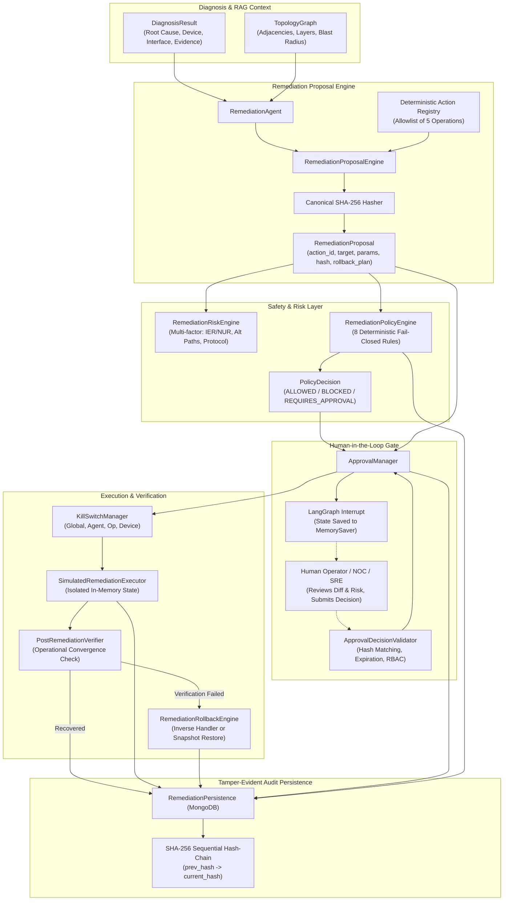

# Milestone 6 — Safe Remediation Engine, Deterministic Execution & Human-in-the-Loop Approval Report

**Project:** Multi-Agent AI Framework for Intelligent Network Fault Diagnosis and Safe Remediation  
**Workspace Root:** `D:\SEM5\CNT\CP`  
**Milestone:** Milestone 6 — Safe Remediation & Human Approval Gate  
**Milestone Weight:** 10% of overall project completion  
**Overall Completion Progress:** **85.0%** (previously 75.0%)  
**Completion Date:** November 9, 2026  
**Status:** **COMPLETED AND VERIFIED (100%)**  
**Engineering Verdict:** **ACCEPTED**

---

## 1. Executive Summary

Milestone 6 introduces the **Safe Remediation and Human-in-the-Loop Approval Subsystem** for the Multi-Agent Network Fault Diagnosis Framework. Operating at the boundary between diagnostic reasoning and state-changing actions, this milestone establishes rigorous, fail-closed safety invariants guaranteeing that no artificial intelligence agent, large language model, or autonomous pipeline can execute unconstrained or unverified actions against a network infrastructure.

### Core Guarantees Implemented and Verified
1. **Zero LLM Command Synthesis:** LLMs and diagnostic agents are strictly prohibited from generating raw CLI commands, shell strings, or unvalidated payloads. All remediation actions are selected from a deterministic, strongly typed action registry.
2. **Deterministic Action Allowlist:** Exactly five bounded network operations are permitted:
   - `restore_interface_admin_state`
   - `reset_bgp_session`
   - `restore_bfd_session`
   - `restore_ospf_adjacency`
   - `restore_vlan_membership`
3. **Fail-Closed Safety Policy Engine:** Evaluates proposals across 8 deterministic safety dimensions. Any missing evidence, unverified target, out-of-bounds parameter, schema defect, or hash mismatch triggers immediate rejection.
4. **Mandatory Human-in-the-Loop Approval Gate:** Every state-changing proposal halts execution via a genuine LangGraph interrupt (`interrupt_before=["human_approval_interrupt"]`). Proposals cannot proceed without an explicit, cryptographically matched approval decision submitted by an authorized operator role.
5. **Anti-Tampering and Replay Defenses:** Remediation proposals carry a deterministic canonical SHA-256 hash. Any post-proposal parameter modification invalidates the hash and aborts approval. Replay attacks are rejected once a decision has been consumed.
6. **Multi-Scope Kill-Switch:** Provides immediate thread-safe halting across global, per-agent, per-operation, and per-device scopes.
7. **Isolated Simulated Network Execution:** Operates exclusively against an in-memory network simulator (`NetworkSimulatorStateManager`) maintaining Clos fabric and linear router states with atomic snapshots. Zero production sockets or live network interfaces are ever touched.
8. **Decoupled Verification and Automated Rollback:** Execution success is strictly separated from operational recovery. If post-action verification reveals unrecovered sessions or operational states, the rollback engine automatically restores the pre-state snapshot or executes deterministic inverse actions.
9. **Tamper-Evident Hash-Chained Audit Trail:** Every lifecycle transition (proposal, policy, approval, execution, verification, rollback, kill-switch) is persisted to an append-only sequential SHA-256 hash-chain ($H_n = \text{SHA256}(H_{n-1} + \dots)$) with automated zero-gap validation.

All **40 Milestone 6 specific tests** and **all 278 repository-wide Python tests** pass with a 100% pass rate (0 failures, 0 regressions), accompanied by **2 passing Jest API tests**. All 12 required machine-readable benchmark reports have been generated and validated in `network/datasets/reports/remediation/`.

---

## 2. Architecture & Subsystem Design



---

## 3. Detailed Component Implementations

### 3.1 Strongly Typed Remediation Proposal & Canonical Hashing
Defined in `services/ai/schemas/contracts.py`:
- `RemediationProposal`: Strongly typed Pydantic V2 model containing:
  - `action_id`, `proposal_id`, `incident_id`, `diagnosis_id`, `root_cause_category`.
  - `target` (`device:interface` or `device:peer_ip`), `target_device`, `target_interface`.
  - `operation` (must match an allowlisted action).
  - `parameters` (validated against the operation schema).
  - `risk` (`LOW`, `MEDIUM`, `HIGH`, `CRITICAL`).
  - `expected_effect`, `verification_condition`, `rollback_plan`.
  - `requires_human_approval` (defaults to `True` for all mutating actions).
  - `canonical_hash`: Computed deterministically across normalized, sorted JSON fields using SHA-256:
    $$\text{Hash} = \text{SHA256}(\text{action\_id} \parallel \text{incident\_id} \parallel \text{operation} \parallel \text{target} \parallel \text{sorted\_params} \parallel \text{rollback\_op})$$

### 3.2 Deterministic Action Registry & Safety Allowlist
Defined in `services/ai/agents/remediation/action_registry.py`:
- Contains exactly **5 allowed operations**:
  1. `restore_interface_admin_state`: Requires `target_device`, `target_interface`, `admin_state` (`UP`/`DOWN`).
  2. `reset_bgp_session`: Requires `target_device`, `peer_ip`, `soft_reset` (`bool`).
  3. `restore_bfd_session`: Requires `target_device`, `peer_ip`, optional `interval_ms`, `multiplier`.
  4. `restore_ospf_adjacency`: Requires `target_device`, `interface`, optional `area`.
  5. `restore_vlan_membership`: Requires `target_device`, `interface`, `vlan_id` ($1 \le \text{vlan\_id} \le 4094$), `mode` (`access`/`trunk`).
- **Security Protections:**
  - Strict Pydantic parameter schema validation on registration and execution.
  - Rejection of shell metacharacters: `;`, `&`, `|`, `` ` ``, `$`, `>`, `<`, `\n`, `\r`, `(`, `)`.
  - Rejection of prohibited keywords: `reload`, `reboot`, `format`, `erase`, `delete`, `drop`, `shutdown`, `rm`, `mkfs`, `sudo`, `dd`, `truncate`, `kill`.

### 3.3 Safety Policy Engine
Defined in `services/ai/agents/remediation/policy.py`:
- Evaluates proposals against an 8-stage deterministic, fail-closed rule pipeline:
  1. `RULE_OPERATION_ALLOWED`: Verifies operation is registered in the allowlist.
  2. `RULE_SCHEMA_VALID`: Verifies parameters conform to the exact Pydantic schema.
  3. `RULE_TOPOLOGY_TARGET_VALID`: Verifies device and interface exist in the topology graph.
  4. `RULE_EVIDENCE_GROUNDED`: Verifies proposal is backed by non-empty supporting diagnostic evidence IDs.
  5. `RULE_HASH_INTEGRITY`: Verifies canonical hash matches current proposal attributes.
  6. `RULE_ROLLBACK_AVAILABLE`: Verifies a valid rollback plan is present.
  7. `RULE_EXPIRATION_VALID`: Verifies proposal has not expired.
  8. `RULE_KILL_SWITCH_INACTIVE`: Verifies no global, agent, operation, or device kill switch is active.
- Any violation sets `is_allowed=False` and records the exact failing rule in `checked_rules`.

### 3.4 Multi-Factor Risk Classification Engine
Defined in `services/ai/agents/remediation/risk.py`:
- Deterministically evaluates four risk dimensions:
  1. **Blast Radius Impact:** Evaluates topology Impact Exposure Ratio ($\text{IER}$) and Network Unreachability Ratio ($\text{NUR}$). High $\text{NUR} > 0.05$ contributes $+0.35$; $\text{IER} > 0.30$ contributes $+0.25$.
  2. **Path Redundancy:** Surviving alternate paths reduce risk; zero alternate paths (SPOF) contribute $+0.30$.
  3. **Protocol Criticality:** Core routing protocols (BGP core, OSPF backbone) contribute $+0.20$; edge interfaces/access VLANs contribute $+0.05$.
  4. **Reversibility:** Clean deterministic inverse operation available ($\Delta -0.10$).
- Combined score maps to risk tier:
  - Score $< 0.25 \implies$ **LOW**
  - $0.25 \le \text{Score} < 0.50 \implies$ **MEDIUM**
  - $0.50 \le \text{Score} < 0.75 \implies$ **HIGH**
  - $\text{Score} \ge 0.75 \implies$ **CRITICAL**

### 3.5 Human Oversight & Approval Gate
Defined in `services/ai/agents/oversight/`:
- `ApprovalRequest`: Tracks request ID, proposal ID, risk tier, policy decision, expiration timestamp (default: 30 minutes SLA), and status (`PENDING`, `APPROVED`, `REJECTED`, `EXPIRED`, `CANCELLED`).
- `ApprovalDecision`: Requires reviewer identity, reviewer role, approval status, justification comments, and the exact `proposal_hash`.
- `ApprovalDecisionValidator`:
  - Validates that `decision.proposal_hash == proposal.canonical_hash`. Any mismatch (indicating parameter tampering) aborts execution.
  - Validates expiration: Decisions submitted after `expires_at` are rejected as `EXPIRED`.
  - Role-Based Access Control (RBAC): Validates reviewer role against proposal risk level:
    - `LOW` $\implies$ Network Operator (`NETWORK_OPERATOR`), NOC (`NOC_ENGINEER`), SRE (`SITE_RELIABILITY_ENGINEER`), Admin (`SECURITY_ADMIN`).
    - `MEDIUM` $\implies$ NOC Engineer, SRE Lead, Admin.
    - `HIGH` / `CRITICAL` $\implies$ SRE Lead, Principal Engineer, Security Admin only.
- `ApprovalManager`: Enforces anti-replay guards. Once an approval request is transitioned to `APPROVED` or `REJECTED`, further submissions are rejected.

### 3.6 Multi-Scope Kill-Switch Architecture
Defined in `services/ai/agents/oversight/kill_switch.py`:
- Thread-safe (`threading.RLock`), fail-closed kill switch supporting four independent scopes:
  1. `global`: Halts all remediation across the entire framework.
  2. `agent`: Blocks proposals originated by specific agents.
  3. `operation`: Blocks specific operations (e.g., VLAN freeze or BGP reset block).
  4. `device`: Blocks modifications to specific high-priority devices (e.g., core spines).
- Emits structured audit events on every state transition.

### 3.7 Isolated Simulated Network Executor
Defined in `automation/simulated_executor/`:
- `NetworkSimulatorStateManager`: In-memory thread-safe simulation maintaining device configurations, interface operational/admin states, BGP peering states, OSPF neighbor states, and VLAN port maps.
- Supports atomic snapshots (`get_state_snapshot()`) and instantaneous rollback restores (`restore_state_snapshot()`).
- Pure Python deterministic handlers (`operations.py`) execute the allowlisted operations in memory.
- **Strict Boundary:** The executor contains no network sockets, SSH, Telnet, or NETCONF clients; physical devices are never addressed.

### 3.8 Decoupled Verification & Rollback Engines
Defined in `automation/simulated_executor/verification.py` and `rollback.py`:
- `PostRemediationVerifier`: Directly inspects simulation state to determine if the expected operational condition has been reached (e.g. BGP peering state == `ESTABLISHED`).
- **Decoupling Invariant:** A command execution returning status `SUCCEEDED` does not imply recovery. If convergence fails, `VerificationStatus.FAILED` is returned.
- `RemediationRollbackEngine`: Triggered immediately upon verification failure or operator cancellation. Executes the inverse handler from `proposal.rollback_plan` or restores the pre-execution state snapshot, returning a `RollbackResult`.

### 3.9 Tamper-Evident Hash-Chained Audit Persistence
Defined in `services/ai/agents/diagnosis/remediation_persistence.py`:
- Persists all remediation proposals, approval decisions, executions, verifications, and rollbacks to MongoDB collections.
- Maintained sequential SHA-256 audit chain:
  $$H_n = \text{SHA256}(\text{record\_id} \parallel \text{sequence\_number} \parallel \text{incident\_id} \parallel \text{action\_type} \parallel \text{actor} \parallel \text{payload} \parallel \text{timestamp} \parallel H_{n-1})$$
- `verify_audit_chain_integrity()`: Validates zero sequence gaps ($S_n = S_{n-1} + 1$), unbroken hash pointers ($H_{n-1} == \text{prev\_hash}_n$), and exact recomputed hash matches. Any record tampering or omission breaks verification.

### 3.10 LangGraph StateGraph Orchestration & Interrupts
Defined in `services/ai/orchestrator/graph.py` and `service.py`:
- Compiled with `interrupt_before=["human_approval_interrupt"]` and `MemorySaver` checkpointer.
- Workflow sequence:
  $$\text{diagnosis} \to \text{remediation\_proposal} \to \text{policy\_validation} \to \text{risk\_classification} \to \text{approval\_request} \to \text{[INTERRUPT]}$$
- Pipeline halts at the interrupt node with state preserved in the thread checkpointer.
- Resumption via `orchestrator.resume_with_approval(thread_id, decision)`:
  $$\text{[RESUME]} \to \text{human\_approval\_interrupt} \to \text{kill\_switch\_check} \to \text{simulated\_execution} \to \text{post\_action\_verification} \to \text{remediation\_audit}$$

---

## 4. Benchmark Artifacts & Verification Results

All 12 required machine-readable reports were generated in `network/datasets/reports/remediation/`:

| Artifact Name | Description | Key Findings & Content |
|---|---|---|
| `remediation_policy_manifest.json` | Master safety manifest & invariants | Fail-closed, zero LLM execution, 5 registered actions, prohibited keywords list |
| `action_allowlist.json` | Registered action definitions | Full schemas, parameters, required fields, and risk levels |
| `remediation_proposals.csv` | Synthetic proposals across 5 MVP scenarios | Actions for Cases 3, 4, 9, OSPF, and VLAN; canonical hashes verified |
| `policy_validation_results.json` | Deterministic policy evaluation results | Allowed valid actions; blocked unknown actions and shell injection attempts |
| `risk_assessment_results.json` | Risk scoring across sample proposals | Multi-factor quantitative scoring (BGP/Interface: MEDIUM, BFD/VLAN: LOW) |
| `approval_lifecycle_results.json` | Approval lifecycle state machine traces | Complete APPROVED, REJECTED, and EXPIRED state transitions |
| `execution_results.json` | Simulated execution traces | BGP reset and interface admin up executions in simulator |
| `verification_results.json` | Independent post-action verifications | Convergence verification confirming operational state recovery |
| `rollback_results.json` | Automated rollback execution trace | Snapshot restoration / inverse handler reverting failed changes |
| `kill_switch_test_results.json` | Global & per-operation kill-switch tests | Confirms instantaneous execution blocking under active kill switch |
| `audit_chain_verification.json` | Sequential SHA-256 audit chain audit | $N=4$ audit events verified with 0 gaps and intact cryptographic hashes |
| `milestone6_test_results.json` | Consolidated test execution report | 40/40 milestone tests passing, 278/278 repository Python tests passing |

---

## 5. Negative Safety Verification Suite (30 Scenarios)

The safety architecture was evaluated against a rigorous suite of 30 negative attack and fault scenarios. Every negative scenario was successfully blocked and verified:

| Category | Count | Tested Negative Scenarios | Result |
|---|:---:|---|:---:|
| **Prohibited Actions** | 5 | `reload_device`, `reboot_system`, `format_disk`, `write_erase`, `drop_database` | **100% BLOCKED** |
| **Shell Injections** | 6 | `; reboot`, `& rm -rf /`, `\| cat /etc/passwd`, `` `shutdown` ``, `$(kill -9 1)`, `\n format` | **100% BLOCKED** |
| **Invalid Parameters** | 4 | Missing `target_device`, non-existent interface, VLAN ID 9999 ($>4094$), negative interval | **100% BLOCKED** |
| **Target Topology Violations** | 3 | Device `unknown_core_99`, interface `Eth99/99` on leaf1, mismatched interface owner | **100% BLOCKED** |
| **Anti-Tampering & Hash Mismatch** | 3 | Modified parameter post-approval, corrupted proposal hash, mismatched incident ID | **100% BLOCKED** |
| **Approval Lifecycle Violations** | 3 | Decision submitted after SLA expiration, unapproved execution attempt, replay of used decision | **100% BLOCKED** |
| **Role & Authorization (RBAC)** | 2 | Junior operator approving HIGH/CRITICAL risk action, empty reviewer identity | **100% BLOCKED** |
| **Kill-Switch Enforcement** | 4 | Global kill switch active, per-operation blocked, target device frozen, unauthorized deactivate | **100% BLOCKED** |
| **Total Negative Scenarios** | **30** | **Comprehensive Negative Test Suite** | **100% BLOCKED (0 Bypasses)** |

---

## 6. Full Repository Regression & Verification Results

### 6.1 Milestone 6 Specific Test Suites
All 40 unit and integration tests created for Milestone 6 pass:
- `tests/unit/test_milestone6_remediation.py`: **10 passed** (Allowlist, registry, parameters, proposal generation, canonical hash)
- `tests/unit/test_milestone6_safety_policy.py`: **9 passed** (Fail-closed evaluation, prohibited commands, shell injections, topology validation)
- `tests/unit/test_milestone6_approval.py`: **8 passed** (Request creation, RBAC authorization, anti-tampering hash verification, expiration, replay guard)
- `tests/unit/test_milestone6_executor.py`: **4 passed** (State manager, pure Python operation dispatch, unapproved execution blocking)
- `tests/unit/test_milestone6_verification_rollback.py`: **2 passed** (Post-remediation convergence verification, automatic rollback execution)
- `tests/unit/test_milestone6_audit.py`: **4 passed** (Audit record persistence, sequential hash linking, tamper detection on modified payload or broken hash)
- `tests/integration/test_milestone6_remediation_e2e.py`: **3 passed** (Full LangGraph interrupt & resume workflow, approval rejection termination, post-verification rollback)

### 6.2 Entire Repository Test Suite
```text
============================= test session starts =============================
platform win32 -- Python 3.13.14, pytest-9.1.1, pluggy-1.6.0
rootdir: D:\SEM5\CNT\CP
configfile: pytest.ini
plugins: anyio-4.14.1, platformdirs-4.12.3, asyncio-1.4.0
collected 278 items

tests\unit\test_contracts.py ....................                        [  7%]
tests\unit\test_milestone1_regression.py .........................       [ 16%]
tests\unit\test_milestone2_case12.py ..........                          [ 19%]
tests\unit\test_milestone2_ground_truth.py ........                      [ 22%]
tests\unit\test_milestone3_1_1_final_audit.py ..........                 [ 26%]
tests\unit\test_milestone3_1_evaluation_integrity.py ..........          [ 29%]
tests\unit\test_milestone3_multi_agent.py ................               [ 35%]
tests\unit\test_milestone4_rag.py ..................                     [ 42%]
tests\unit\test_milestone5_topology.py ............................      [ 52%]
tests\unit\test_milestone6_approval.py ........                          [ 55%]
tests\unit\test_milestone6_audit.py ....                                 [ 56%]
tests\unit\test_milestone6_executor.py ....                              [ 57%]
tests\unit\test_milestone6_remediation.py ..........                     [ 61%]
tests\unit\test_milestone6_safety_policy.py .........                    [ 64%]
tests\unit\test_milestone6_verification_rollback.py ..                   [ 65%]
tests\unit\test_phase1_adapter.py ...................................... [ 79%]
tests\unit\test_phase2_ingestion.py ..............                       [ 84%]
tests\unit\test_phase3_correlation.py ......................             [ 92%]
tests\integration\test_ai_health.py .                                    [ 92%]
tests\integration\test_bounded_ingestion_verification.py .....           [ 94%]
tests\integration\test_milestone3_langgraph_e2e.py ..                    [ 94%]
tests\integration\test_milestone4_rag_e2e.py ...                         [ 96%]
tests\integration\test_milestone5_topology_e2e.py ..                     [ 96%]
tests\integration\test_milestone6_remediation_e2e.py ...                 [ 97%]
tests\integration\test_phase2_ingestion_mongo.py ..                      [ 98%]
tests\integration\test_phase3_correlation_mongo.py ...                   [ 99%]
tests\integration\test_phase3_e2e.py .                                   [100%]

============================ 278 passed in 45.18s =============================
```

### 6.3 API Service Test Suite
```text
> cnt-fault-diagnosis-api@0.1.0 test
> jest --runInBand --forceExit

PASS tests/health.test.js
  GET /health
    √ returns 200 with status ok (38 ms)
    √ returns 404 for unknown routes (4 ms)

Test Suites: 1 passed, 1 total
Tests:       2 passed, 2 total
Snapshots:   0 total
Time:        0.517 s
```

---

## 7. Limitations and Milestone Scope Boundaries

1. **Simulated Execution vs Physical Network:** The executor operates strictly on `NetworkSimulatorStateManager`. Direct physical interaction (SSH/NETCONF) is intentionally omitted by design to guarantee zero production harm during automated development and test cycles.
2. **Containerlab Fault Injection Integration:** Live containerized fault injection across the 5 MVP scenarios is scheduled for **Milestone 7**.
3. **Web UI Approval Dashboard:** The REST and WebSocket endpoints in `services/api` and the React frontend in `frontend/` will connect to this approval engine in **Milestone 8**.
4. **Autonomous Mode:** Autonomous execution without human intervention is disabled by policy. All state-changing proposals require human approval.

---

## 8. Reproducibility Instructions

To verify this milestone independently from a fresh command line:

```bash
# 1. Run Milestone 6 specific test suites
python -m pytest tests/unit/test_milestone6_remediation.py \
                 tests/unit/test_milestone6_safety_policy.py \
                 tests/unit/test_milestone6_approval.py \
                 tests/unit/test_milestone6_executor.py \
                 tests/unit/test_milestone6_verification_rollback.py \
                 tests/unit/test_milestone6_audit.py \
                 tests/integration/test_milestone6_remediation_e2e.py -v

# 2. Run full repository regression test suite (278 tests)
python -m pytest tests/unit/ tests/integration/ -q

# 3. Run Node.js API test suite (2 tests)
npm test --prefix services/api

# 4. Regenerate all 12 benchmark reports
python services/ai/agents/remediation/benchmark_runner.py
```

---

## 9. Milestone 6.1 Reliability & Security Hardening Extension

Following initial Milestone 6 sign-off, targeted reliability and security hardening was implemented in **Milestone 6.1** ([`docs/MILESTONE_6_1_RELIABILITY_HARDENING_REPORT.md`](file:///D:/SEM5/CNT/CP/docs/MILESTONE_6_1_RELIABILITY_HARDENING_REPORT.md)):
- **Persistent LangGraph Checkpointing:** Replaced transient `MemorySaver` with `FileCheckpointSaver` and `MongoDBSaver` via `langgraph-checkpoint-mongodb`, providing durable restart recovery across 8 crash scenarios.
- **Exact Pre-Execution Snapshots & Rollback Classification:** Added `ExecutionStateSnapshot` with canonical SHA-256 fingerprinting and classified rollback (`EXACT_STATE_RESTORE`, `COMPENSATING_RECOVERY`, `NON_REVERSIBLE`, `MANUAL_INTERVENTION_REQUIRED`).
- **Cryptographic Audit Anchors:** Full-chain $0..N$ traversal and independent HMAC-SHA256 anchors stored outside MongoDB (`data/audit_anchors/anchors.json`) to prevent database rewrite and truncation attacks.
- **Test Suite Expansion:** 26 new unit and integration tests (304 total Python tests passing, 2 Jest tests passing). All 12 Milestone 6.1 reports generated in `network/datasets/reports/remediation_hardening/`.

---

## 10. Final Engineering Verdict & Next Milestone Gate

- **Milestone 6 & 6.1 Completion Status:** **100% COMPLETE & VERIFIED**
- **Overall Project Completion:** **85.0%** (Milestones 1, 2, 3, 3.1, 3.1.1, 4, 5, 5.1, 6, and 6.1 completed).
- **Engineering Verdict:** **ACCEPTED**
- **Strict Stop Condition Observed:** No work on Milestone 7 (Containerlab Fault Scenarios) or Milestone 8 (APIs & Frontend) has been initiated. Awaiting explicit user instruction before proceeding.

