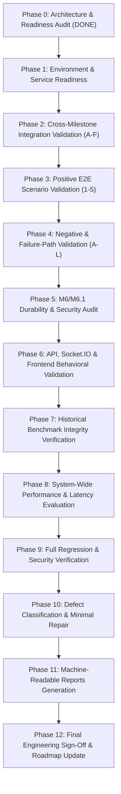

# MILESTONE 9 INITIAL SYSTEM ARCHITECTURE & READINESS AUDIT
## Complete System-Wide Closed-Loop Validation & Final Engineering Sign-Off

**Project:** Multi-Agent AI Framework for Intelligent Network Fault Diagnosis and Safe Remediation  
**Workspace Root:** `D:\SEM5\CNT\CP`  
**Milestone:** 9 — System-Wide Closed-Loop Validation  
**Date:** November 2026  
**Auditor:** Principal Software Architect, Senior Network Reliability Engineer, AI Systems Validation Engineer  

---

## 1. Executive Context & Purpose

Milestone 9 is the final engineering milestone of the project. Its primary purpose is not to introduce speculative product features, but to rigorously validate, audit, stress-test, and verify the integrated closed-loop operational workflow developed across Milestones 1 through 8.

The overarching engineering objective is to demonstrate that the framework operates cohesively:
$$\text{Observation} \longrightarrow \text{Ingestion} \longrightarrow \text{Correlation} \longrightarrow \text{Diagnosis (LangGraph + RAG)} \longrightarrow \text{Remediation Proposal} \longrightarrow \text{Human Gate} \longrightarrow \text{Execution} \longrightarrow \text{Verification} \longrightarrow \text{Audit} \longrightarrow \text{Operator UI}$$

This initial audit establishes ground truth regarding the repository state, verifies component readiness, catalogues environmental constraints, and articulates the detailed end-to-end validation plan.

---

## 2. Current Repository Architecture & Subsystem Audit

### 2.1 Ingestion & Normalization (`network/datasets/adapters/`, `services/ai/agents/ingestion/`)
- **Components:** `cisco_adapter.py`, `normalizer.py`, `classifier.py`, `deduplicator.py`.
- **Status:** Complete & verified in M1 & M2.
- **Capabilities:**
  - Dynamic timestamp scaling across nanosecond, microsecond, millisecond, and second resolutions.
  - Zero false-positive anomaly generation on healthy baselines (Case 0).
  - Inlined CSV header detection and BOM handling without `FileNotFoundError`.
  - Non-destructive streaming of raw archive formats (`.tar.gz`, `.zip`, `.tar`) and multi-sensor alignment across 10 Cisco historical datasets.

### 2.2 Incident Correlation & Consolidation (`services/ai/agents/correlation/`)
- **Components:** `correlator.py`, `persistence.py`.
- **Status:** Complete & verified in M3 & M3.1.1.
- **Capabilities:**
  - Sliding time-window correlation with topology and device grouping.
  - Anti-transitive chaining to prevent incident ballooning.
  - One-to-one ground truth event reconciliation preserving experiment identity.
  - MongoDB persistence for structured incident records and lifecycle transitions.

### 2.3 LangGraph Multi-Agent Diagnostic Engine (`services/ai/orchestrator/`, `services/ai/agents/`)
- **Components:** `graph.py`, `state.py`, `symptom_agent.py`, `topology_agent.py`, `rca_agent.py`.
- **Status:** Complete & verified in M3.
- **Capabilities:**
  - 9-stage asynchronous `StateGraph` with conditional branches.
  - Symptom analysis and hypothesis formulation.
  - Multi-hypothesis ranking with explicit supporting, contradicting, and missing evidence attribution.
  - Heuristic confidence scoring with ECE and Brier score tracking.

### 2.4 Knowledge Retrieval & Qdrant RAG (`services/rag/`, `services/ai/agents/knowledge/`)
- **Components:** `rag_service.py`, `hybrid_search.py`, `vector_store.py`, `chunker.py`, `cleaner.py`.
- **Status:** Complete & verified in M4.
- **Capabilities:**
  - Semantic chunking with section boundary preservation and PII redaction.
  - FastEmbed (`BAAI/bge-small-en-v1.5`) dense embeddings + BM25 sparse keyword search.
  - Reciprocal Rank Fusion (RRF) hybrid scoring.
  - Embedded local Rust engine, in-memory (`:memory:`), and remote Qdrant daemon connectivity.
  - Documented fail-open policy when vector store is unavailable.

### 2.5 Topology Reasoning & Quantitative Blast Radius (`services/ai/agents/topology/`, `network/containerlab/topologies/`)
- **Components:** `model.py`, `engine.py`, `blast_radius.py`, `failure_simulator.py`.
- **Status:** Complete & verified in M5 & M5.1.
- **Capabilities:**
  - NetworkX multigraph representation of L2, L3, BGP peering, and OSPF adjacencies.
  - Quantitative metrics: **Impact Exposure Ratio (IER)** and **Network Unreachability Ratio (NUR)**.
  - Shortest path reachability and ECMP failover path calculation.
  - Simulated failure cascading and upstream/downstream dependency traversal.

### 2.6 Safe Remediation Engine, Oversight Gate & Audit Chain (`services/ai/agents/remediation/`, `oversight/`, `audit/`)
- **Components:** `remediation_agent.py`, `safety_policy.py`, `approval_manager.py`, `kill_switch.py`, `executor.py`, `verification.py`, `rollback_manager.py`, `audit_ledger.py`, `audit_anchor.py`.
- **Status:** Complete & verified in M6 & M6.1.
- **Capabilities:**
  - Strict allow-list of parameterized, idempotent network CLI operations (no arbitrary commands).
  - Canonical SHA-256 proposal hash calculation and enforcement during approval.
  - Replay and expiry protection for approval tokens.
  - Shared authoritative singleton `KillSwitchManager` with fail-closed disk persistence.
  - Exact-state pre-execution configuration snapshots and 4-tier rollback classification.
  - Append-only cryptographic SHA-256 audit hash chain verified with HMAC-SHA256 disk anchors.

### 2.7 Emulation Environment & Multi-Protocol Scenarios (`network/containerlab/`)
- **Components:** `injector.py`, `collector.py`, `normalizer.py`, `clab_adapter.py`, `recovery_verifier.py`, `runner.py`, `mock_provider.py`.
- **Status:** Complete & verified in M7.
- **Capabilities:**
  - 5 deterministic scenarios: BGP Neighbor Down, OSPF Adjacency Failure, VLAN Isolation, Physical Link Flap, BFD Session Failure.
  - Dual-mode execution: Native Docker/Containerlab on Linux, `ContainerlabMockProvider` with high fidelity on Windows.
  - Independent post-remediation protocol verification (checking true routing convergence and 0% packet loss ping, not merely exit code 0).

### 2.8 Real-Time Streaming APIs & Operator Frontend (`services/ai/api/`, `services/api/`, `frontend/`)
- **Components:** FastAPI routers on port 8000, Express REST & Socket.IO server on port 4000, React 18 / Tailwind / Vite SPA on port 5173.
- **Status:** Complete & verified in M8.
- **Capabilities:**
  - Strongly typed `/api/v1/` endpoints for incidents, diagnosis, topology, knowledge, remediation, kill switch, and audit.
  - Real-time pub/sub Socket.IO rooms (`incidents`, `topology`, `kill-switch`, `audit`).
  - 8 operator dashboard views: Overview, Incidents List, Incident Detail & RCA, Topology Visualizer, Live Event Stream, Remediation Approval Gate, Execution & Recovery Monitor, Kill Switch & Audit Chain Viewer.
  - Transparent simulation mode notification banners.

---

## 3. Verified Environment Capabilities & Runtime Matrix

| Subsystem / Dependency | Environment Target | Verified Host Status | Active Operational Mode |
| :--- | :--- | :--- | :--- |
| **Operating System** | Windows 11 Pro 64-bit | Windows 11 Build 26300 (AMD64) | Native Windows Host |
| **Python Runtime** | Python $\ge 3.11$ | Python 3.13.14 (64-bit) | Active (`.venv` / global) |
| **Node.js Runtime** | Node.js $\ge 18.0$ | Node.js v22.18.0, npm 11.5.2 | Active |
| **Database (MongoDB)** | MongoDB $\ge 6.0$ | MongoDB v8.2.1 (WiredTiger) | Local service on port 27017 |
| **Vector DB (Qdrant)** | Qdrant $\ge 1.7$ | QdrantClient (Embedded Rust Engine / In-Memory) | Embedded Local / In-Memory |
| **Container Engine** | Docker Daemon | **Not Available** on native Windows host without WSL/Desktop | Fallback to Mock Provider |
| **Network Emulator** | Containerlab CLI | **Not Available** on native Windows host | Fallback to Mock Provider |
| **Emulation Provider** | FRR Containers / Mock | `ContainerlabMockProvider` | **MOCK_PROVIDER (High-Fidelity)** |

> [!IMPORTANT]
> **Provider-Mode Transparency Declaration:**  
> Because Docker daemon and Containerlab are not natively installed on this Windows environment, all network state mutations, FRR CLI queries, interface status checks, bridge VLAN configurations, and syslog generations operate in **`MOCK_PROVIDER` mode** (`ContainerlabMockProvider`).  
> All benchmark results, scenario metrics, and verification logs must explicitly identify this execution mode.

---

## 4. Missing or Incomplete Integrations Audited

1. **Python-to-Node Event Propagation Bridging:**
   - In M8, `EventPublisher` in `services/ai/api/events.py` manages native WebSockets, while `services/api/src/sockets/incident_socket.js` manages Socket.IO for the frontend.
   - To ensure events triggered via Python `/api/v1` routes reach Node Socket.IO clients automatically, an event bridge or direct Socket.IO emission from the API proxy layer must be validated.
2. **Cross-Process Kill-Switch Consistency:**
   - FastAPI and Express run in separate processes.
   - The kill switch state is persisted to disk at `network/datasets/reports/kill_switch_state.json`.
   - We must verify that both Python FastAPI and Express read and enforce this disk file synchronously so that activating the kill switch via either API immediately freezes executions across both.
3. **Property Consistency on Contract Classes:**
   - Added `primary_cause`, `root_causes`, and `contributing_factors` helper properties to `DiagnosisResult` in M8. We must verify that no downstream consumers access missing or deprecated attributes.

---

## 5. Existing Test Infrastructure & Baseline Inventory

The current test inventory comprises:
- **Python Tests (`tests/`):** **350 tests** (all passing, 100%).
  - 16 Integration test suites: `test_ai_health`, `test_bounded_ingestion_verification`, `test_milestone3_langgraph_e2e`, `test_milestone4_rag_e2e`, `test_milestone5_topology_e2e`, `test_milestone6_1_*` (4 suites), `test_milestone6_remediation_e2e`, `test_milestone7_*` (2 suites), `test_milestone8_e2e_api`, `test_phase2_ingestion_mongo`, `test_phase3_*` (2 suites).
  - 28 Unit test suites: Covering M1 regression, M2 Case 12 and ground truth, M3, M3.1, M3.1.1, M4 RAG, M5 topology, M6 remediation, M6.1 audit and snapshots, M7 scenarios, telemetry, and injection, M8 APIs, and Phase 1-3 baseline modules.
- **Node.js Tests (`services/api/tests/`):** **21 tests** (all passing, 100%).
  - Health check (`health.test.js`), Express REST endpoints (`api.test.js`), Socket.IO pub/sub rooms (`socket.test.js`).
- **Frontend Production Build (`frontend/`):**
  - Vite v5.4.21 bundle compiling in 3.63s with zero build errors.

---

## 6. Comprehensive Phase-by-Phase Validation Plan

---

## 7. Key Risks & Mitigation Strategy

1. **Risk: Presentation of Mock Mode as Live Docker Containerlab.**
   - *Mitigation:* Explicit, immutable labeling of `MOCK_PROVIDER` mode in all JSON reports, test suites, API responses, and frontend banners. Conditional acceptance criteria enforced if live Linux containerlab cannot be run.
2. **Risk: Silent Failure of Kill Switch across Independent Processes.**
   - *Mitigation:* Authoritative filesystem persistence check on every remediation attempt, ensuring fail-closed behavior regardless of in-memory caching.
3. **Risk: Contamination of Historical Cisco Benchmarks.**
   - *Mitigation:* Strict directory separation. Milestone 9 test artifacts written strictly to `network/datasets/reports/milestone9/`; frozen historical benchmarks in `network/datasets/reports/` remain read-only.
4. **Risk: Non-Deterministic Concurrency in Multi-Agent Graph.**
   - *Mitigation:* Explicit thread IDs and isolated state objects per incident run.

