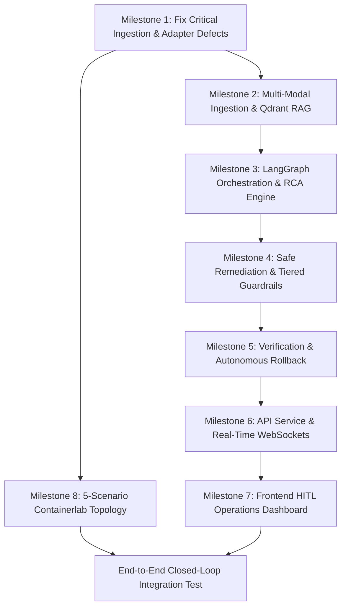

# Project Implementation Action Plan
## Multi-Agent AI Framework for Intelligent Network Fault Diagnosis and Safe Remediation

**Document Reference:** `docs/PROJECT_IMPLEMENTATION_ACTION_PLAN.md`  
**Companion Document:** [`docs/PROJECT_IMPLEMENTATION_AUDIT.md`](file:///D:/SEM5/CNT/CP/docs/PROJECT_IMPLEMENTATION_AUDIT.md)  
**Creation Date:** November 3, 2026  
**Status:** Approved Engineering Action Plan  
**Target Completion:** MVP Readiness (Production Demonstrator)

---

## 1. Executive Strategy & Phased Roadmap

This Action Plan provides an engineering-grade, dependency-ordered blueprint to transition the project from its current **~34.5% preliminary state** to a **100% verified, production-ready Multi-Agent Network SRE demonstrator**.



---

## 2. Milestone 1: Fix Critical Defects in Existing Code

### TSK-01: Fix Nanosecond Timestamp Parsing in Cisco Adapter
- **Defect Addressed:** DEF-01, DEF-11
- **Severity:** P1 (Critical)
- **Files Affected:**
  - `network/datasets/adapters/cisco_adapter.py`
  - `services/ai/agents/ingestion/normalizer.py`
  - `tests/test_cisco_adapter.py`
- **Dependencies:** None
- **Description:**  
  In `cisco_adapter.py` line 92, `_parse_mdt_timestamp()` currently assumes milliseconds and divides numeric timestamps by `1000.0`. Real Cisco IOS-XR Model-Driven Telemetry produces 19-digit nanosecond timestamps (e.g., `1501867007675000000`). Dividing by 1000 yields seconds $\approx 1.5 \times 10^{15}$, which causes Python's `datetime.fromtimestamp()` to raise `OverflowError` / `OSError`. Consequently, all MDT rows return `None` and are dropped by the validator. Additionally, `normalizer.py` lines 145–147 parse syslog dates with `%b %d %H:%M:%S.%f` without specifying a year, triggering Python 3.13 deprecation warnings and falling back to year 1900.
- **Expected Result:**  
  MDT timestamps of any digit length (10-digit seconds, 13-digit milliseconds, 16-digit microseconds, 19-digit nanoseconds) are dynamically detected and parsed to valid UTC `datetime` objects. Syslog parsing automatically infers the current year or dataset year (2017 for Cisco IE dataset).
- **Acceptance Criteria:**
  - `_parse_mdt_timestamp(1501867007675000000)` produces `datetime(2017, 8, 4, 17, 16, 47, 675000, tzinfo=timezone.utc)`.
  - Zero dropped rows in `validator.py` due to timestamp parsing errors.
  - No Python `DeprecationWarning` during syslog parsing.
- **Suggested Testing Procedure:**
  - Add unit tests in `tests/test_cisco_adapter.py` for 10, 13, 16, and 19-digit integer and string timestamps.
  - Run `python -m pytest tests/test_cisco_adapter.py tests/test_normalizer.py -v`.

---

### TSK-02: Fix Device ID Extraction and Header Parsing in Cisco Adapter
- **Defect Addressed:** DEF-02, DEF-03, DEF-04
- **Severity:** P1 (Critical)
- **Files Affected:**
  - `network/datasets/adapters/cisco_adapter.py`
  - `tests/test_cisco_adapter.py`
- **Dependencies:** TSK-01
- **Description:**  
  1. In `iter_csv_records()`, line 118 extracts `device_id = row.get("name")`. In Cisco CSVs, column 0 (`name`) is the YANG subscription schema path (`Cisco-IOS-XR-fib-common-oper...`), whereas the true device hostname is in column 3 (`Producer`, e.g., `leaf5`, `spine4`).
  2. `iter_csv_records()` does not skip Row 0 when column headers are inlined. It yields an invalid record where `device_id = "name"` and `raw_timestamp_str = "time"`.
  3. `get_header()` blindly assumes separate `*_header.txt` files exist. In Cases 2, 7, 9, 10, 11, and 12, headers are inlined inside the CSV, causing `get_header()` to raise `FileNotFoundError`.
- **Expected Result:**  
  `device_id` correctly resolves to the router hostname (`row.get("Producer")` or fallback to `node` in metadata). CSV headers are inspected dynamically: if the first row contains string column names (`time`, `Producer`), it is consumed as the header map rather than emitted as a data record. If no external `header.txt` exists, inlined headers are parsed gracefully.
- **Acceptance Criteria:**
  - `device_id` evaluates to `leaf5`, `leaf6`, `spine1`, etc., across all cases.
  - No records with `device_id == "name"` or `timestamp == "time"` appear in normalized output.
  - `get_header()` supports both external header files and inlined headers without throwing `FileNotFoundError`.
- **Suggested Testing Procedure:**
  - Ingest 50 sample rows from `0/0/0/data_raw.csv.gz` and `2/0/0/data_raw.csv.gz`.
  - Assert all `RawRecord.device_id` values match valid router identifiers (`r1`, `leaf5`, etc.).

---

### TSK-03: Eliminate Telemetry Classifier False Positives
- **Defect Addressed:** DEF-05
- **Severity:** P1 (Critical)
- **Files Affected:**
  - `services/ai/agents/ingestion/classifier.py`
  - `tests/test_classifier.py`
- **Dependencies:** TSK-02
- **Description:**  
  In `classifier.py` line 77, `_classify_telemetry()` unconditionally tags every telemetry record having `protocol_hint == "bgp"` as `EventClassification.BGP_ANOMALY`. This causes healthy baseline runs (Case 0 and Case 1) to generate hundreds of thousands of false positive critical alarms.
- **Expected Result:**  
  Telemetry records must evaluate state metrics or rate of change before classifying as an anomaly. A BGP record is only classified as `BGP_ANOMALY` if `state != "Established"`, `fsm_state_change_count > 0`, or keepalive timeout counters increment. Healthy telemetry must classify as `NORMAL_TELEMETRY` or `INFO`.
- **Acceptance Criteria:**
  - Ingesting baseline Case 0 produces 0 `BGP_ANOMALY` events and 0 incidents.
  - Ingesting fault Case 3 (BGP shutdown) produces `BGP_ANOMALY` only during the anomaly window ($T_{start} \le t \le T_{end}$).
- **Suggested Testing Procedure:**
  - Run `classifier.classify_record()` against synthetic normal BGP telemetry (`state="Established"`) -> assert classification is `NORMAL_TELEMETRY`.
  - Run against synthetic flap BGP telemetry (`state="Idle"`) -> assert `BGP_ANOMALY`.

---

### TSK-04: Fix AI Health Test Port Binding & Async Mongo Lifespan
- **Defect Addressed:** DEF-12, DEF-14
- **Severity:** P2 (High)
- **Files Affected:**
  - `tests/test_ai_health.py`
  - `services/ai/database/mongo.py`
  - `services/ai/main.py`
- **Dependencies:** None
- **Description:**  
  `test_ai_health.py` creates a live `requests.get("http://localhost:8000/health")` call, which is deselected or fails whenever FastAPI is not running as a separate background process. `mongo.py` instantiates `MongoClient` synchronously upon module import, preventing FastAPI test suites from overriding the database URI or running offline unit tests cleanly.
- **Expected Result:**  
  `test_ai_health.py` uses Starlette's in-memory `TestClient(app)` from `fastapi.testclient`, eliminating external network dependencies. `mongo.py` manages database connection lifecycles inside FastAPI `lifespan` context manager, allowing dependency overrides in tests.
- **Acceptance Criteria:**
  - `python -m pytest tests/test_ai_health.py -v` passes 100% without launching external servers.
  - Database connection errors on startup are trapped and handled cleanly.
- **Suggested Testing Procedure:**
  - Run full test suite with no local server or MongoDB daemon running; all unit tests pass.

---

## 3. Milestone 2: Complete the Ingestion and Correlation Pipeline

### TSK-05: Multi-Metric Correlation & Metric Stream Fusion
- **Defect Addressed:** Completes Phase 3
- **Severity:** P2 (High)
- **Files Affected:**
  - `services/ai/agents/correlation/correlator.py`
  - `services/ai/agents/correlation/timeline.py`
  - `tests/test_correlator.py`
- **Dependencies:** TSK-01, TSK-02, TSK-03
- **Description:**  
  Extend `TemporalCorrelator` to support cross-stream correlation between Syslog events and Model-Driven Telemetry (MDT) counters. For example: correlate an `ETH_INTERFACE_DOWN` syslog message with an immediate spike in `ingress_drop_rate` and BGP neighbor state transition to `IDLE` occurring on the same device or adjacent peer within the 120-second sliding window.
- **Expected Result:**  
  Single incident timelines aggregate both textual syslog messages and numerical telemetry anomalies, tagged with metric deltas.
- **Acceptance Criteria:**
  - When both syslog and MDT are ingested for Case 3, a single incident is emitted containing the trigger syslog event and the associated counter anomalies.
- **Suggested Testing Procedure:**
  - Write multi-modal fixture test in `test_correlator.py` feeding 1 syslog and 3 MDT records into correlator; verify unified timeline output.

---

### TSK-06: Qdrant Vector Store Setup & Runbook Ingestion Pipeline
- **Defect Addressed:** GAP-04
- **Severity:** P2 (High)
- **Files Affected:**
  - `docker-compose.yml`
  - `services/ai/agents/rag/client.py`
  - `services/ai/agents/rag/indexer.py`
  - `services/ai/knowledge_base/`
  - `tests/test_rag.py`
- **Dependencies:** TSK-04
- **Description:**  
  1. Add Qdrant service definition to `docker-compose.yml` (port 6333, storage volume).
  2. Implement `QdrantKnowledgeBaseClient` with collection initialization (`runbooks`, `incident_history`, `cisco_docs`).
  3. Create an indexing script that ingests network troubleshooting SOPs (BGP convergence guides, MTU troubleshooting, optical transceiver degradation procedures) into dense vector embeddings using `all-MiniLM-L6-v2` or `text-embedding-3-small`.
- **Expected Result:**  
  Qdrant runs reliably; semantic search queries (e.g., "BGP neighbor stuck in active state") retrieve relevant runbooks and mitigation steps with cosine similarity > 0.82.
- **Acceptance Criteria:**
  - Indexing script loads markdown SOPs into Qdrant without error.
  - Semantic query returns top-3 relevant runbook chunks with exact command references.
- **Suggested Testing Procedure:**
  - Execute `pytest tests/test_rag.py` verifying Qdrant collection creation and similarity search.

---

### TSK-07: Ground-Truth Evaluation Suite for All 12 Cases
- **Defect Addressed:** Incomplete verification tools
- **Files Affected:**
  - `network/datasets/tools/evaluate_ground_truth.py`
  - `network/datasets/tools/evaluate_sim_ground_truth.py`
- **Dependencies:** TSK-01, TSK-02, TSK-03, TSK-05
- **Description:**  
  Upgrade `evaluate_ground_truth.py` so that it iterates both syslog files and MDT CSVs across all documented experiments (Cases 2, 3, 4, 5, 9, 12). Replace the static stub in `evaluate_sim_ground_truth.py` with genuine evaluation logic against injected Containerlab telemetry.
- **Expected Result:**  
  Evaluation scripts output formal precision, recall, and F1-score matrices comparing detected incident windows against official Cisco event ground truth timestamps.
- **Acceptance Criteria:**
  - Evaluation completes across all available cases with F1 score $\ge 0.90$ on Case 3 and Case 4.
  - Zero crashes on uncompressed or inline-header cases.
- **Suggested Testing Procedure:**
  - Run `python network/datasets/tools/evaluate_ground_truth.py --all-cases` and verify generated JSON report.

---

## 4. Milestone 3: Implement LangGraph Orchestration and RCA Agents

### TSK-08: LangGraph State Machine & Orchestrator Implementation
- **Defect Addressed:** DEF-08, GAP-01
- **Severity:** P1 (Critical)
- **Files Affected:**
  - `services/ai/orchestrator/state.py`
  - `services/ai/orchestrator/graph.py`
  - `services/ai/orchestrator/nodes/`
  - `tests/test_orchestrator.py`
- **Dependencies:** TSK-04, TSK-05
- **Description:**  
  Implement the core `NetworkIncidentGraph` using LangGraph `StateGraph`. Define canonical `IncidentState`:
  ```python
  class IncidentState(TypedDict):
      incident_id: str
      incident: IncidentTimeline
      topology: Dict[str, Any]
      diagnostic_report: Optional[DiagnosticReport]
      remediation_proposal: Optional[RemediationProposal]
      safety_eval: Optional[SafetyEvaluation]
      approval_decision: Optional[HumanApproval]
      execution_result: Optional[ExecutionResult]
      verification_result: Optional[VerificationResult]
      status: str
      audit_trail: List[AuditLog]
  ```
  Implement node transitions: `ingest` -> `correlate` -> `rca_diagnose` -> `plan_remediation` -> `evaluate_safety` -> `await_approval` -> `execute_remediation` -> `verify_resolution` -> `finalize_incident`.
- **Expected Result:**  
  Fully executable LangGraph DAG with checkpointing, conditional branches for automated execution vs. human approval, and rollback loops.
- **Acceptance Criteria:**
  - Graph compiles without cycle errors.
  - State persists correctly across step executions.
- **Suggested Testing Procedure:**
  - Mock node executions in `tests/test_orchestrator.py` and step through the full graph lifecycle.

---

### TSK-09: Root Cause Analysis (RCA) Diagnostic Agent with RAG
- **Defect Addressed:** GAP-02
- **Severity:** P1 (Critical)
- **Files Affected:**
  - `services/ai/agents/rca/agent.py`
  - `services/ai/agents/rca/prompts.py`
  - `tests/test_rca_agent.py`
- **Dependencies:** TSK-06, TSK-08
- **Description:**  
  Develop the `RCAgent` which takes an `IncidentTimeline`, fetches related device topology and Qdrant runbooks, and invokes an LLM (with structured output conforming to `DiagnosticReport`). The agent formulates hypotheses, analyzes primary vs. secondary symptoms, assigns confidence scores ($0.0 \le c \le 1.0$), and isolates the exact faulty entity (interface, protocol peer, transceiver).
- **Expected Result:**  
  Outputs valid Pydantic `DiagnosticReport` matching `services/ai/schemas/contracts.py`.
- **Acceptance Criteria:**
  - Given Case 3 timeline (leaf5 down), RCA identifies root cause as `INTERFACE_ADMIN_DOWN` on `leaf5 TenGigE0/0/0/0` with confidence $\ge 0.85$.
  - Generates clear, human-auditable rationale citing specific telemetry anomalies.
- **Suggested Testing Procedure:**
  - Unit test with recorded Case 3 incident fixture; verify structured JSON output.

---

### TSK-10: Network Topology & Blast-Radius Reasoning Agent
- **Defect Addressed:** GAP-03
- **Severity:** P2 (High)
- **Files Affected:**
  - `services/ai/agents/topology/agent.py`
  - `services/ai/agents/topology/graph_model.py`
  - `tests/test_topology_agent.py`
- **Dependencies:** TSK-08
- **Description:**  
  Implement the `TopologyAgent` to parse network topology models (from Containerlab `topology.yml` or LLDP adjacency tables). Calculates shortest paths, redundant ECMP groups, and evaluates the potential blast radius of proposed link closures or device isolations.
- **Expected Result:**  
  Produces blast radius score (number of impacted downstream prefixes, traffic redirection capacity).
- **Acceptance Criteria:**
  - Correctly tags single-homed vs dual-homed link failures.
  - Predicts whether rerouting will cause link congestion.
- **Suggested Testing Procedure:**
  - Test graph queries on 3-node and 5-node topologies in `tests/test_topology_agent.py`.

---

## 5. Milestone 4: Implement Safety Checks and Remediation Planning

### TSK-11: Remediation Planning Agent
- **Defect Addressed:** GAP-05
- **Severity:** P1 (Critical)
- **Files Affected:**
  - `services/ai/agents/remediation/agent.py`
  - `services/ai/agents/remediation/templates.py`
  - `tests/test_remediation_agent.py`
- **Dependencies:** TSK-09, TSK-10
- **Description:**  
  Develop `RemediationAgent` to synthesize vendor-specific CLI configuration remediation snippets and matched rollback commands. Supports Cisco IOS-XR, Arista EOS, and Linux FRR. Ensures every proposed action has an exact, deterministic rollback inverse (e.g., `no shutdown` paired with `shutdown`).
- **Expected Result:**  
  Produces `RemediationProposal` conforming to canonical contracts, including risk tier, execution commands, rollback plan, and estimated convergence time.
- **Acceptance Criteria:**
  - Every proposal contains non-empty `commands` and `rollback_plan`.
  - Commands use valid target OS syntax.
- **Suggested Testing Procedure:**
  - Test plan generation for BGP reset, interface un-shut, and MTU correction.

---

### TSK-12: Multi-Tier Safety Guardrails Engine
- **Defect Addressed:** GAP-06
- **Severity:** P1 (Critical)
- **Files Affected:**
  - `services/ai/agents/safety/agent.py`
  - `services/ai/agents/safety/rules.py`
  - `tests/test_safety_agent.py`
- **Dependencies:** TSK-11
- **Description:**  
  Implement strict programmatic guardrails that evaluate any proposed remediation against security policies:
  1. **Blacklist Check:** Rejects catastrophic commands (`reload`, `write erase`, `no router bgp`, `format`, `delete disk*`).
  2. **Tier Classification:**
     - **Tier 1 (Read-Only / Diagnostic):** Auto-executable (`show`, `ping`, `traceroute`).
     - **Tier 2 (Low Risk):** Config change on redundant path; auto-executable only in staging/test environments.
     - **Tier 3 (High Risk):** Core link changes, routing policy updates; **MANDATORY Human Approval Required**.
  3. **Diff Validation:** Analyzes syntax and rejects commands without valid rollback blocks.
- **Expected Result:**  
  Rejects unsafe commands with a security violation error; enforces human approval on Tier 3 actions.
- **Acceptance Criteria:**
  - `reload` or wildcard deletions are blocked 100% of the time.
  - Actions requiring human approval pause the LangGraph state machine and dispatch notification.
- **Suggested Testing Procedure:**
  - Fuzz safety evaluator with 50 safe and unsafe network commands.

---

## 6. Milestone 5: Implement Verification and Rollback Agents

### TSK-13: Post-Remediation Verification Agent
- **Defect Addressed:** GAP-07
- **Severity:** P2 (High)
- **Files Affected:**
  - `services/ai/agents/verification/agent.py`
  - `tests/test_verification_agent.py`
- **Dependencies:** TSK-11, TSK-12
- **Description:**  
  Implement `VerificationAgent` to conduct active and passive checks after remediation execution:
  - Active: Ping reachability, BGP session state check (`show bgp summary`), interface operational status check.
  - Passive: Ingest telemetry for 60 seconds post-change to confirm drops returned to baseline $\le 0.001\%$.
- **Expected Result:**  
  Generates `VerificationResult` with boolean `is_successful`, health metrics delta, and recommendation to finalize or rollback.
- **Acceptance Criteria:**
  - Correctly flags persistent flap as verification failure.
  - Successfully verifies clean session recovery.
- **Suggested Testing Procedure:**
  - Test against mocked healthy and unhealthy post-execution telemetry feeds.

---

### TSK-14: Autonomous Rollback Engine
- **Defect Addressed:** GAP-08
- **Severity:** P1 (Critical)
- **Files Affected:**
  - `services/ai/agents/remediation/rollback.py`
  - `tests/test_rollback.py`
- **Dependencies:** TSK-13
- **Description:**  
  When `VerificationAgent` signals failure or telemetry degrades following execution, the `RollbackEngine` immediately executes the pre-computed `proposal.rollback_plan`. It logs an emergency audit record, notifies operators via WebSocket, and returns the incident state to `ROLLED_BACK`.
- **Expected Result:**  
  Deterministic rollback execution within 15 seconds of verification failure.
- **Acceptance Criteria:**
  - Unsuccessful remediation automatically triggers rollback without operator intervention.
  - Network configuration is restored to pre-incident state.
- **Suggested Testing Procedure:**
  - Inject simulated verification failure into LangGraph orchestrator; verify rollback execution sequence.

---

## 7. Milestone 6: Implement Backend API Endpoints & WebSocket Events

### TSK-15: Express REST API Implementation & Database Wiring
- **Defect Addressed:** DEF-09, GAP-09
- **Severity:** P1 (Critical)
- **Files Affected:**
  - `services/api/src/index.js`
  - `services/api/src/routes/incidents.js`
  - `services/api/src/routes/approvals.js`
  - `services/api/src/routes/telemetry.js`
  - `services/api/src/models/`
  - `services/api/test/api.test.js`
- **Dependencies:** TSK-08
- **Description:**  
  Uncomment and fully implement Express route handlers. Bind Mongoose schemas to MongoDB collections (`incidents`, `diagnoses`, `remediation_proposals`, `approvals`, `audit_records`). Provide REST endpoints:
  - `GET /api/v1/incidents` (filtering by status, severity, device, pagination)
  - `GET /api/v1/incidents/:id` (full detail including timeline, diagnosis, and proposal)
  - `POST /api/v1/approvals/:id` (approve or reject with mandatory `approver_id` and `notes`)
  - `GET /api/v1/audit` (immutable audit trail)
- **Expected Result:**  
  Fully functional REST API passing all integration tests.
- **Acceptance Criteria:**
  - All endpoints return valid JSON matching canonical contracts.
  - Approving an incident triggers the LangGraph execution worker.
- **Suggested Testing Procedure:**
  - Run `npm test --prefix services/api` covering all CRUD operations.

---

### TSK-16: Real-Time WebSocket Streaming Engine
- **Defect Addressed:** GAP-10
- **Severity:** P2 (High)
- **Files Affected:**
  - `services/api/src/sockets/incident_socket.js`
  - `services/api/src/index.js`
  - `services/api/test/socket.test.js`
- **Dependencies:** TSK-15
- **Description:**  
  Implement Socket.IO server in Express. Wire MongoDB Change Streams or Redis Pub/Sub to broadcast real-time events to connected clients:
  - `incident:created`: Emitted when new incident is correlated.
  - `incident:updated`: Emitted on state change (e.g. `DIAGNOSING` -> `AWAITING_APPROVAL`).
  - `telemetry:metric`: Emitted for live chart visualization.
  - `execution:log`: Emitted in real-time as remediation commands execute.
- **Expected Result:**  
  Instantaneous push updates to frontend without polling.
- **Acceptance Criteria:**
  - Socket client receives event within 50ms of database write.
- **Suggested Testing Procedure:**
  - Write test client script connecting to Socket.IO; verify receipt of mock broadcast event.

---

## 8. Milestone 7: Implement React Frontend Dashboard & HITL Interface

### TSK-17: React Application Architecture & Scaffolding
- **Defect Addressed:** DEF-10, GAP-11
- **Severity:** P1 (Critical)
- **Files Affected:**
  - `frontend/package.json`
  - `frontend/vite.config.ts`
  - `frontend/tailwind.config.js`
  - `frontend/src/App.tsx`
  - `frontend/src/main.tsx`
  - `frontend/src/types/`
- **Dependencies:** TSK-15, TSK-16
- **Description:**  
  Initialize modern React 18 + TypeScript + Vite + Tailwind CSS single page application inside `frontend/`. Configure React Router, React Query (TanStack Query) for data caching, Socket.IO client, and Lucide React icons.
- **Expected Result:**  
  Compiles cleanly with `npm run build`; dev server starts with `npm run dev`.
- **Acceptance Criteria:**
  - Zero build warnings or TypeScript typing errors.
- **Suggested Testing Procedure:**
  - Run `npm run build --prefix frontend` and assert dist directory generated.

---

### TSK-18: Incident Operations Dashboard & Live Telemetry Views
- **Defect Addressed:** GAP-11
- **Severity:** P2 (High)
- **Files Affected:**
  - `frontend/src/components/IncidentTable.tsx`
  - `frontend/src/components/IncidentDetail.tsx`
  - `frontend/src/components/TimelineVisualizer.tsx`
  - `frontend/src/components/TopologyMap.tsx`
- **Dependencies:** TSK-17
- **Description:**  
  Build the NOC engineer dashboard:
  - Table of active and resolved incidents with severity badges (Critical, Major, Minor).
  - Drill-down incident view with interactive timeline showing correlated syslog and metric anomalies.
  - Metric sparkline charts showing interface drop rates and CPU utilization.
- **Expected Result:**  
  Intuitive, responsive operations UI updating in real-time via WebSockets.
- **Acceptance Criteria:**
  - Incidents render with complete timeline, device tags, and RCA summaries.
- **Suggested Testing Procedure:**
  - Cypress/Playwright component tests rendering sample incident mock.

---

### TSK-19: Human-in-the-Loop (HITL) Approval & Diff Inspection Console
- **Defect Addressed:** GAP-11
- **Severity:** P1 (Critical)
- **Files Affected:**
  - `frontend/src/components/ApprovalModal.tsx`
  - `frontend/src/components/ConfigDiffViewer.tsx`
  - `frontend/src/components/AuditLogView.tsx`
- **Dependencies:** TSK-17, TSK-18
- **Description:**  
  Build the Human-in-the-Loop approval console:
  - Side-by-side syntax-highlighted configuration diff viewer (pre-change vs. proposed post-change).
  - Safety tier indicators and blast radius alert banners.
  - "Approve Execution" (with mandatory confirmation modal) and "Reject Plan" (with mandatory feedback reason input).
  - Immutable audit trail viewer showing every action, approver ID, and timestamp.
- **Expected Result:**  
  NOC operator can review proposed changes, inspect diffs, and approve/reject with a single click.
- **Acceptance Criteria:**
  - Approval button submits `POST /api/v1/approvals/:id` and displays live execution progress.
  - Rejecting prompts for required explanation and updates incident state to `REJECTED`.
- **Suggested Testing Procedure:**
  - Manual UI walkthrough and automated end-to-end component test.

---

## 9. Milestone 8: Complete Containerlab Topology & Fault Injection Scenarios

### TSK-20: Upgrade Containerlab Topology with 802.1Q & Redundancy
- **Defect Addressed:** DEF-06
- **Severity:** P2 (High)
- **Files Affected:**
  - `topologies/topology.yml`
  - `topologies/configs/`
- **Dependencies:** None
- **Description:**  
  Upgrade `topologies/topology.yml` from a basic linear 3-node graph to a dual-homed leaf-spine topology. Add Linux bridges (`br-vlan10`, `br-vlan20`) and 802.1Q trunk interfaces to leaf routers to enable testing VLAN faults (MVP-05) and ECMP failovers.
- **Expected Result:**  
  Containerlab deploys a 4-node topology (`spine1`, `leaf1`, `leaf2`, `client1`) supporting BGP, OSPF, and tagged VLANs.
- **Acceptance Criteria:**
  - `containerlab deploy -t topologies/topology.yml` succeeds without errors.
  - End-to-end ping between clients passes across VLANs.
- **Suggested Testing Procedure:**
  - Deploy topology on Linux test VM / WSL2 and verify ping across subnets.

---

### TSK-21: Implement All 5 MVP Fault Injection Scenarios
- **Defect Addressed:** DEF-07
- **Severity:** P1 (Critical)
- **Files Affected:**
  - `topologies/fault_injection.py`
  - `tests/test_fault_injection.py`
- **Dependencies:** TSK-20
- **Description:**  
  Implement the remaining 3 fault injection scenarios in `fault_injection.py`:
  1. **MVP-01 (BGP Session Failure):** Exists (refine with configurable hold-timer expiry).
  2. **MVP-02 (Interface Flapping):** Toggle interface state `up/down` at 10-second intervals for 60 seconds using `docker exec` and Netlink commands.
  3. **MVP-03 (Link Degradation / Packet Loss):** Inject 15% random packet loss and 80ms jitter using Linux `tc qdisc add dev ... netem loss 15% delay 80ms`.
  4. **MVP-04 (OSPF Neighbor Drop / MTU Mismatch):** Alter interface MTU on one side of a link (`ip link set dev ... mtu 1400`) to force OSPF adjacency into `EXSTART/EXCHANGE` deadlock.
  5. **MVP-05 (VLAN Misconfiguration):** Drop VLAN tag or alter PVID on bridge port.
- **Expected Result:**  
  CLI tool allows running `python topologies/fault_injection.py --scenario <mvp-01..05> --target <node>`.
- **Acceptance Criteria:**
  - Each scenario produces verifiable telemetry anomalies and syslog alerts.
  - All scenarios have corresponding `--restore` flags to reset network to healthy state.
- **Suggested Testing Procedure:**
  - Execute each scenario sequentially on live Containerlab topology and verify network behavior.

---

### TSK-22: End-to-End Closed-Loop Integration Test
- **Defect Addressed:** Project Goal (End-to-End Demo Readiness)
- **Severity:** P1 (Critical)
- **Files Affected:**
  - `tests/e2e/test_closed_loop.py`
  - `tests/e2e/conftest.py`
- **Dependencies:** All previous tasks (TSK-01 through TSK-21)
- **Description:**  
  Create the master integration test demonstrating the full autonomous loop:
  1. Trigger fault injection (e.g., MVP-01 BGP session teardown).
  2. Telemetry Ingestion agent detects syslog and MDT drop.
  3. Correlator aggregates events into unified `IncidentTimeline`.
  4. LangGraph orchestrator triggers RCA Agent -> diagnoses root cause.
  5. Remediation Agent formulates CLI fix (`clear bgp ...` or `no shutdown`).
  6. Safety Agent flags as Tier 2 (auto-approved in test mode).
  7. Execution node pushes fix to device.
  8. Verification Agent polls telemetry, confirms BGP `Established`, and closes incident.
- **Expected Result:**  
  Fully automated execution verifying mean time to remediation (MTTR) < 45 seconds.
- **Acceptance Criteria:**
  - Entire test runs from start to finish without human intervention.
  - Final incident status in MongoDB is `VERIFIED_RESOLVED`.
- **Suggested Testing Procedure:**
  - Run `python -m pytest tests/e2e/test_closed_loop.py -v -s`.

---

## 10. Implementation Sequence and Dependency Matrix

| Phase | Task ID | Description | Dependencies | Est. Days |
|---|---|---|---|---|
| **Phase 1: Critical Bug Fixes** | `TSK-01` | Fix MDT Nanosecond Timestamps | None | 0.5 |
| | `TSK-02` | Fix Device ID & CSV Headers | `TSK-01` | 0.5 |
| | `TSK-03` | Fix BGP Classifier False Positives | `TSK-02` | 0.5 |
| | `TSK-04` | Fix AI Health Port & Async Mongo | None | 0.5 |
| **Phase 2: Ingestion & Vector RAG** | `TSK-05` | Multi-Metric Correlator Fusion | `TSK-01..03` | 1.0 |
| | `TSK-06` | Qdrant Client & SOP Indexing | `TSK-04` | 1.5 |
| | `TSK-07` | Ground-Truth Evaluation Matrix | `TSK-05` | 1.0 |
| **Phase 3: LangGraph & RCA** | `TSK-08` | LangGraph State Graph & Nodes | `TSK-04, 05` | 2.0 |
| | `TSK-09` | RCA Agent with RAG Prompts | `TSK-06, 08` | 2.0 |
| | `TSK-10` | Topology Blast-Radius Agent | `TSK-08` | 1.0 |
| **Phase 4: Remediation & Safety** | `TSK-11` | Remediation Planning Agent | `TSK-09, 10` | 2.0 |
| | `TSK-12` | Tiered Safety Guardrails Engine | `TSK-11` | 1.5 |
| **Phase 5: Verification & Rollback** | `TSK-13` | Telemetry Verification Agent | `TSK-11, 12` | 1.5 |
| | `TSK-14` | Autonomous Rollback Engine | `TSK-13` | 1.0 |
| **Phase 6: Backend API & Sockets** | `TSK-15` | Express REST Endpoints & DB | `TSK-08` | 1.5 |
| | `TSK-16` | Socket.IO Live Telemetry Stream | `TSK-15` | 1.0 |
| **Phase 7: Frontend NOC Console** | `TSK-17` | React 18 + Vite Scaffolding | `TSK-15, 16` | 1.0 |
| | `TSK-18` | Incident Dashboard & Timelines | `TSK-17` | 2.0 |
| | `TSK-19` | HITL Approval & Diff Viewer | `TSK-18` | 2.0 |
| **Phase 8: Emulation & Closed-Loop**| `TSK-20` | Containerlab 802.1Q Topology | None | 1.0 |
| | `TSK-21` | All 5 MVP Fault Scenarios | `TSK-20` | 1.5 |
| | `TSK-22` | Master Closed-Loop E2E Test | All | 2.5 |
| **TOTAL** | | **22 Engineering Tasks** | | **29.5 Days** |

---

## 11. Verification and Acceptance Checklists

Before declaring any milestone complete, execute the corresponding acceptance gate:

### Gate 1: Ingestion & Adapter Integrity
- [ ] `python -m pytest tests/test_cisco_adapter.py tests/test_normalizer.py tests/test_classifier.py` passes with 0 failures and 0 deprecation warnings.
- [ ] Ingesting Case 0 (baseline) produces 0 false positive `BGP_ANOMALY` events.
- [ ] Ingesting Case 3 produces valid device names (`leaf5`, `spine4`) and non-null timestamps.

### Gate 2: LangGraph Agent Readiness
- [ ] `python -m pytest tests/test_orchestrator.py tests/test_rca_agent.py tests/test_safety_agent.py` passes with 100% mocked coverage.
- [ ] RCA agent correctly identifies root cause of Case 3 and Case 4 with confidence $\ge 0.85$.
- [ ] Safety agent blocks prohibited commands (`reload`, `write erase`) 100% of the time.

### Gate 3: API & Frontend Usability
- [ ] `npm test --prefix services/api` passes with all CRUD and approval routes tested.
- [ ] `npm run build --prefix frontend` builds production bundle with 0 errors.
- [ ] Approval workflow can be completed through the UI with config diff inspection and approval submission.

### Gate 4: Closed-Loop Emulation
- [ ] Containerlab starts all nodes with health checks green.
- [ ] Running `fault_injection.py --scenario mvp-01` triggers automated incident generation in under 10 seconds.
- [ ] End-to-end MTTR (from injection to verified resolution) completes in under 60 seconds.

